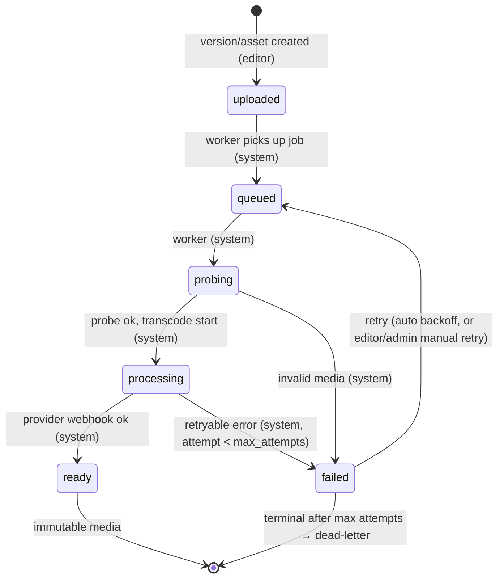
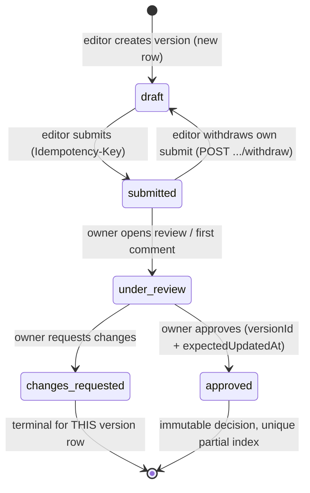
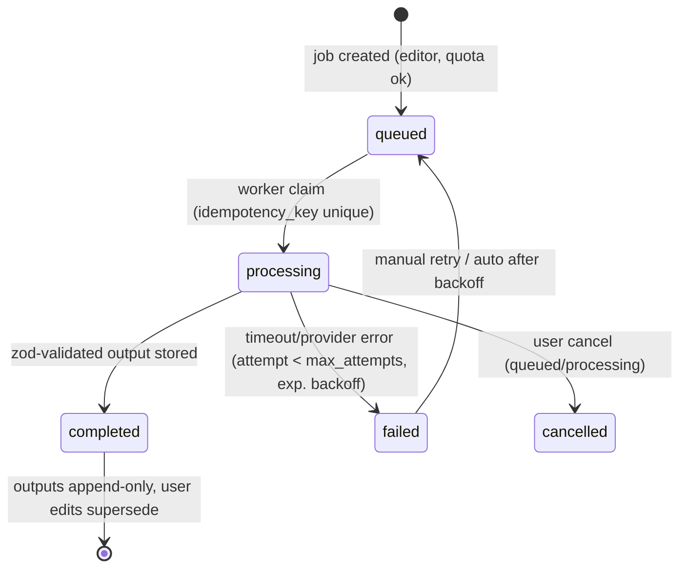
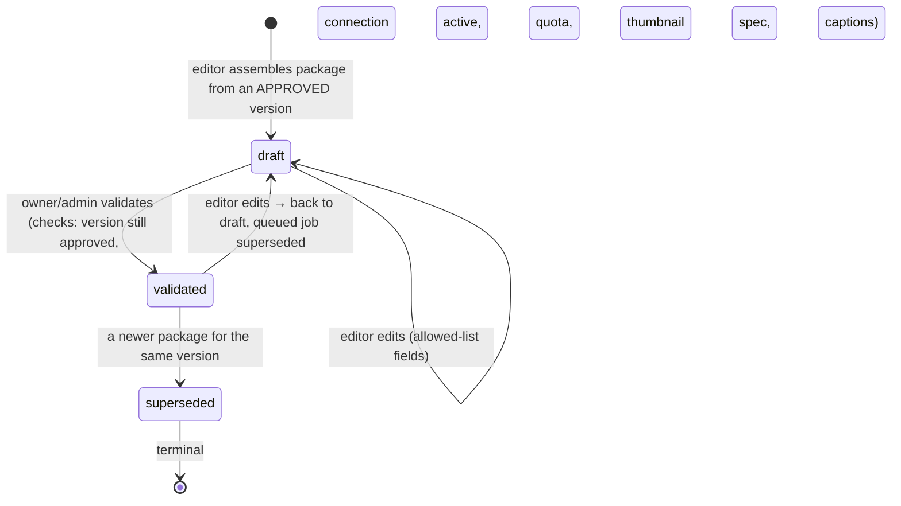
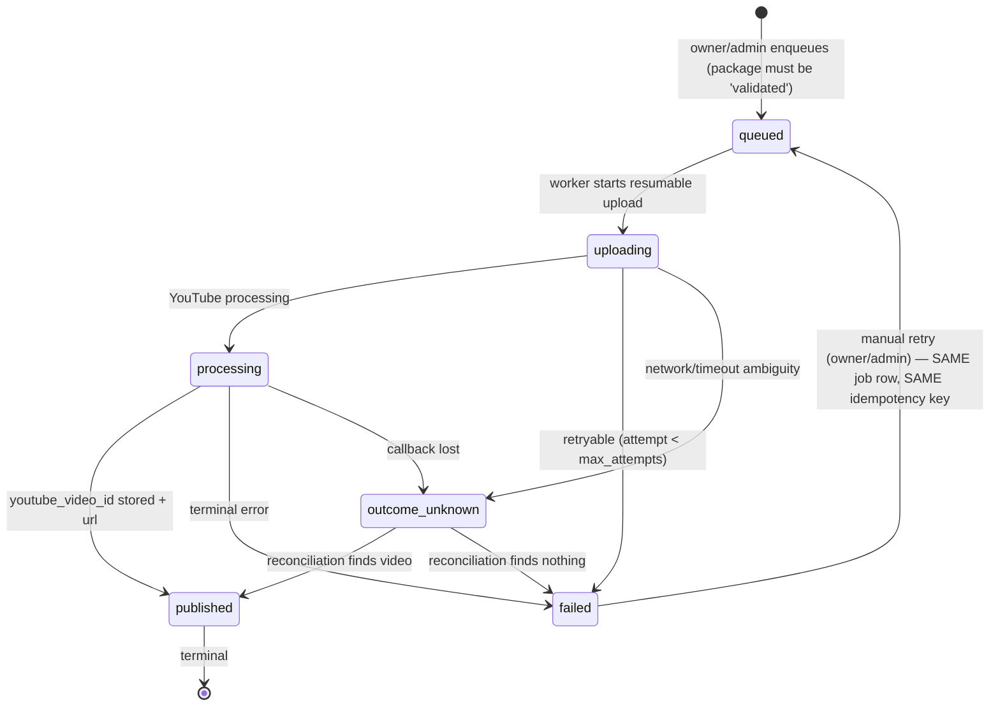

# CreatorFlow — API Contract & Modules

Status: **Proposed**. All endpoints live under `/v1` on the API service (current routes already use `/v1/*`, verified `server/server.ts:62-68` — prefix kept, host split preserved).

---

## 1. Conventions

### 1.1 Transport & auth

- HTTPS only; session cookie (`cf_session`, opaque 256-bit token) is `HttpOnly; Secure; SameSite=Lax; Path=/`.
- **No access/refresh tokens in response bodies** (reverses verified `server/utils/jwt.ts:47-52` and `user.controller.ts:244-246`).
- Mutating requests require CSRF double-submit token header `X-CSRF-Token` (cookie `cf_csrf`, non-HttpOnly) because state-changing endpoints accept cookie auth.
- All responses `Content-Type: application/json`.

### 1.2 Response envelope

```jsonc
// success
{ "data": <payload>, "meta": { "requestId": "req_...", "page": { "nextCursor": "..." } } }
// error
{ "error": { "code": "VERSION_STALE", "message": "human readable", "details": [ { "path": "...", "issue": "..." } ] }, "meta": { "requestId": "req_..." } }
```

Stable machine-readable `code` values: `UNAUTHENTICATED`(401), `FORBIDDEN`(403), `NOT_FOUND`(404), `VALIDATION_FAILED`(422), `CONFLICT`(409), `IDEMPOTENCY_MISMATCH`(409), `IDEMPOTENCY_IN_PROGRESS`(409), `VERSION_STALE`(409), `VERSION_NOT_APPROVED`(409), `PACKAGE_SUPERSEDED`(409), `CSRF_FAILED`(403), `RATE_LIMITED`(429), `QUOTA_EXCEEDED`(429), `INTERNAL`(500).
Internal error messages are never leaked (reverses verified `server/middleware/error.ts:33-36`); `INTERNAL` returns only `requestId`.

### 1.3 Pagination, filtering, sorting

- Cursor keyset pagination: `?limit=50&cursor=<opaque>`; `meta.page.nextCursor`.
- Filtering: `?status=`, `?from=`, `?to=`, `?q=` per module; no ad-hoc query strings.
- Sorting: whitelisted `sort` values only (`created_at_desc` default).

### 1.4 Validation

- Request schemas zod-validated at the route boundary; failure → 422 `VALIDATION_FAILED` with per-field details.
- Body allow-lists (explicit pick) — reverses mass assignment (verified `video.controller.ts:63-71`).

### 1.5 Idempotency

- Header `Idempotency-Key` **required** on: upload session creation, version submit, approval decision, publish package creation, publish job creation, AI job creation, invitation send.
- Server stores `(workspace_id, endpoint, key)` → response snapshot for 24 h (`idempotency_record`, `DATABASE_SCHEMA_AND_ERD.md` §2.1); same key + same body replays the stored response; same key + different body → 409 `IDEMPOTENCY_MISMATCH`; a request still in flight → 409 `IDEMPOTENCY_IN_PROGRESS` (client backs off and retries — it must not issue a second write).
- **Two key spaces, one order of evaluation (resolved).** Beyond the request header, jobs carry their own permanent `idempotency_key` (unique in the DB): `ai_job` (`task:version:target:paramsHash`), `video_processing_job`, `publish_job` (`workspace:version:channel`). These keys are derived from **stable business facts**, not from the header, and they never expire.
  The API therefore evaluates keys in a fixed order:
  1. **Derived job key first.** If a job already exists for the derived key, return that job's identity and the existing resource — never create a second job. This holds forever, well past the 24 h window.
  2. **Request header second.** If no derived job exists, use the `idempotency_record` window to dedupe the request itself.
  Consequence: the 24 h window can never allow a duplicate job for the same business fact, and the permanent job key can never reject a legitimate *second, different* request after the window expires.
- **Publish key stability:** `publish_job.idempotency_key` is `workspace:version:channel` — it contains **no attempt counter**. An earlier draft used `workspace:version:channel:attemptBatch`, which changed on every retry and therefore could not deduplicate a retry of the same publish — the exact case idempotency exists for. A retry reuses the same key and resumes the same job row. Publishing the same version to the same channel again is impossible by construction (versions are immutable); a genuinely new publish needs a new version.

### 1.6 Rate limits (reverses verified V8, no limiter today)

| Class | Limit |
|---|---|
| Auth (login, registration, activation, reset) | 10/min/IP + 5/15min per account |
| Upload session create | 60/hour/workspace |
| AI job create | plan-based/minute + monthly quota |
| Publish create | 30/hour/workspace |
| General authenticated API | 600/min/session |
| Socket connections | 10/user, 100/workspace |

Headers: `X-RateLimit-Limit/Remaining/Reset`, 429 with `Retry-After`.

### 1.7 Roles (per workspace)

| Role | Capabilities summary |
|---|---|
| `owner` | everything incl. billing, YouTube connect, approve, delete workspace |
| `admin` | everything except billing/workspace delete/transfer |
| `editor` | create/upload/edit/submit projects, comment, AI runs, revisions, **prepare publish packages** (`draft` only); **no** approval, **no** publish execution, **no** YouTube connect, **no** billing |
| `viewer` | **read-only**: view projects, versions, comments, transcripts, captions, packages and jobs. **Cannot** comment, create, edit, approve or publish |
| `platform admin` | `user.is_platform_admin` flag + explicit admin endpoints + audit entry; **replaces the hardcoded e-mail bypass** (verified `server/middleware/auth.ts:47-50`) |

**Viewer vs commenter — resolved (OD-03).** The earlier draft said "`viewer` = read + comment (if granted a `commenter` flag later; v1: read-only)", which was self-contradictory: it granted comment rights to viewers and then took them away. The canonical rule is: **`viewer` is read-only in v1.** Commenting requires `editor` or above. A separate `commenter` role is deferred to a later version and is recorded as **OD-03** — resolved *for v1* as "viewers cannot comment"; it is not implemented and not implied anywhere in this contract.

**Editor vs publish execution — resolved.** Preparing a publish package and executing a publish are different acts with different risk. An `editor` may assemble and edit a package (`draft` state only). **Validating** a package (`draft → validated`) and **enqueuing** a publish job require `owner`/`admin`. The `publish_package` and `publish_job` split that enforces this is specified in `DATABASE_SCHEMA_AND_ERD.md` §2.8.

Authorization is enforced **server-side on every endpoint** (client-side guards like `client/app/hooks/adminProtected.tsx:11-18` are cosmetic only).

---

## 2. API directory structure (canonical)

The canonical backend layout is `SYSTEM_COMPONENT_ARCHITECTURE.md` §3; this section shows only how HTTP concerns sit inside each module. **This tree supersedes any other layout shown in the companion documents.**

```
server/src/
  api.ts                   # Express app assembly: mounts all routers, error envelope, requestId
  modules/
    <module>/              # identity, workspaces, projects, assets, versions, review,
                           # captions, ai, thumbnails, youtube, publishing, notifications,
                           # audit, usage, admin
      routes.ts            # HTTP + socket entry points, role guards
      service.ts           # business rules, transactions, state machines
      repository.ts        # Prisma access — the ONLY place that touches tables
      schema.ts            # zod request/response schemas
      index.ts             # public surface; cross-module imports use this only
      *.test.ts            # unit + contract tests, colocated
  platform/
    http/                  # error envelope, requestId, body limits
    middleware/            # authenticate, requireRole, workspaceScope, rateLimit, csrf,
                           # idempotency, validate(schema), audit
  openapi/                 # generated OpenAPI 3.1 from zod (contract tests)
```

Cross-module HTTP calls never happen: the publishing module calls the review module's `index.ts` in-process, not its routes. The current flat structure (`server/routes/*.ts`, `server/controllers/*.ts`, verified) is migrated into this layout during Phase 1; legacy marketplace routes move under `server/legacy/` unchanged except Phase-0 security fixes.

---

## 3. Endpoint catalogue

Legend: **Auth** = session required; **Role** = minimum workspace role; ✓ = Idempotency-Key required.

### 3.1 Identity (`/v1/auth`, `/v1/me`)

| Method | Path | Auth | Role | Input → Output | Notes |
|---|---|---|---|---|---|
| POST | `/auth/register` | no | — | email, name, password → 202 `{status:"verification_sent"}` | creates `pending` user; **no token/password in response** (reverses V4) |
| POST | `/auth/verify-email` | no | — | token (32-byte single-use) → 204 | rate-limited |
| POST | `/auth/login` | no | — | email, password → 204 + cookies | generic error message, rate-limited (V8) |
| POST | `/auth/logout` | yes | any | → 204, revokes session | |
| GET | `/auth/sessions` | yes | any | → list of active sessions | |
| DELETE | `/auth/sessions/:id` | yes | any | → 204 | server-side revocation |
| POST | `/auth/forgot-password` | no | — | email → 202 always | enumeration-safe |
| POST | `/auth/reset-password` | no | — | token, new password → 204 | revokes all sessions |
| GET | `/auth/oauth/:provider/start` | no | — | → 302 to Google | server-side state, PKCE |
| GET | `/auth/oauth/:provider/callback` | no | — | code → 204 + cookies | **identity verified server-side** (reverses V2 `user.controller.ts:260-285`) |
| GET | `/me` | yes | any | → `{user, memberships}` | **never returns tokens/password fields** (reverses V6/V7) |
| PATCH | `/me` | yes | any | name, avatarUrl → user | allow-listed fields |

### 3.2 Workspaces (`/v1/workspaces`)

| Method | Path | Auth | Role | Notes |
|---|---|---|---|---|
| GET | `/workspaces` | yes | any | user's memberships |
| POST | `/workspaces` | yes | any | ✓ creator becomes `owner`; quota row created |
| GET | `/workspaces/:wsId` | yes | member | |
| PATCH | `/workspaces/:wsId` | yes | `admin`+ | name, settings |
| DELETE | `/workspaces/:wsId` | yes | `owner` | two-stage: archive → purge (30 d) |
| GET | `/workspaces/:wsId/audit` | yes | `admin`+ | cursor-paginated `audit_event` |

### 3.3 Members & invitations

| Method | Path | Role | Notes |
|---|---|---|---|
| GET | `/workspaces/:wsId/members` | member | |
| PATCH | `/workspaces/:wsId/members/:id` | `owner`/`admin` | change role; **cannot demote last owner** (409) |
| DELETE | `/workspaces/:wsId/members/:id` | `owner`/`admin` | self-leave allowed; writes audit |
| POST | `/workspaces/:wsId/invites` | `admin`+ | ✓ email, role → 202; 32-byte token **hash** stored (replaces weak codes, V5 pattern) |
| POST | `/invites/:token/accept` | yes | — | requires membership-less user; single-use |
| DELETE | `/workspaces/:wsId/invites/:id` | `admin`+ | revoke |

### 3.4 Projects

| Method | Path | Role | Notes |
|---|---|---|---|
| GET | `/workspaces/:wsId/projects` | member | filters: status, reviewState, q |
| POST | `/workspaces/:wsId/projects` | `editor`+ | ✓ title, description → auto `key` |
| GET | `/workspaces/:wsId/projects/:id` | member | includes roll-up review state |
| PATCH | `/workspaces/:wsId/projects/:id` | `editor`+ | allow-list |
| DELETE | `/workspaces/:wsId/projects/:id` | `admin`+ | archive first |
| GET/POST/DELETE | `.../projects/:id/members` | `admin`+ / `editor` (grant own?) | v1: admin-managed |

### 3.5 Assets & uploads

| Method | Path | Role | Notes |
|---|---|---|---|
| POST | `/workspaces/:wsId/uploads` | `editor`+ | ✓ filename, byteSize, sha256, mimeType → `{uploadId, target}` (presigned or tus URL) |
| POST | `/workspaces/:wsId/uploads/:uploadId/complete` | `editor`+ | ✓ creates `video_asset`, enqueues `asset.process` |
| GET | `/workspaces/:wsId/uploads/:uploadId` | `editor`+ | resume info: bytes received |
| DELETE | `/workspaces/:wsId/uploads/:uploadId` | `editor`+ | abort |
| GET | `/workspaces/:wsId/assets` | member | library listing, filters (state, project, q) |
| GET | `/workspaces/:wsId/assets/:id` | member | |
| PATCH | `/workspaces/:wsId/assets/:id` | `editor`+ | title only |
| DELETE | `/workspaces/:wsId/assets/:id` | `admin`+ | soft delete + storage lifecycle enqueue |

File validation (worker + API): extension/MIME/codec allow-list, `ffprobe`-style probe before transcode, max size by plan, **no SSRF-able URLs accepted** (upload only by direct-to-storage URL issued by us — reverses base64→Cloudinary pattern, V12).

### 3.6 Versions & playback

| Method | Path | Role | Notes |
|---|---|---|---|
| GET | `/workspaces/:wsId/projects/:id/versions` | member | version list with review/processing state |
| POST | `/workspaces/:wsId/projects/:id/versions` | `editor`+ | ✓ from asset or new upload → `version_number = max+1` |
| GET | `/workspaces/:wsId/versions/:id` | member | immutable fields; 409 on attempts to mutate |
| GET | `/workspaces/:wsId/versions/:id/playback` | member | short-lived signed playback URL/HLS manifest token — **replaces unauthenticated VdoCipher OTP** (`server/routes/video.route.ts:31`) |
| POST | `/workspaces/:wsId/versions/:id/submit` | `editor`+ | ✓ **`review_state` must be `draft` or `changes_requested`** → `submitted`; enqueues review notification |
| POST | `/workspaces/:wsId/versions/:id/withdraw` | `editor`+ (the submitter) | `submitted` → `draft`; only the user who submitted it, and only before it is `under_review` |

**Submit guard (resolved).** The earlier row read "`draft|changes_requested|approved?` → `submitted`", which admitted an **approved** version back into review and therefore broke the core invariant that an approved version is a terminal decision. Canonical rule: submit is accepted **only** from `draft` or `changes_requested`. `submitted`, `under_review` and `approved` all reject with `409 CONFLICT`. Corrections to an approved version always require a **new version row** — never re-submitting the approved one.

**Withdraw endpoint (added — resolves a missing endpoint).** The review state machine in §5.2 has always contained a `submitted → draft` transition ("editor withdraws submit"), but no endpoint implemented it, so the transition was unreachable. `POST /workspaces/:wsId/versions/:id/withdraw` is the missing endpoint. It is restricted to the version's own submitter and is refused once the version is `under_review` (a reviewer has already engaged) or in any terminal state. Withdrawing does not delete the version and does not touch any comment or approval.

### 3.7 Comments & review

| Method | Path | Role | Notes |
|---|---|---|---|
| GET | `/workspaces/:wsId/versions/:id/comments` | member | `?from=&to=` time range, `?status=open` |
| POST | `/workspaces/:wsId/versions/:id/comments` | **`editor`+** | ✓ body, timeSeconds, endSeconds?, kind; FK forces exact version (product rule). **`viewer` is read-only** (§1.7) |
| PATCH | `/workspaces/:wsId/comments/:id` | author or `admin`+ | body, status(resolve) |
| DELETE | `/workspaces/:wsId/comments/:id` | author or `admin`+ | soft delete |
| POST | `/workspaces/:wsId/comments/:id/replies` | **`editor`+** | |
| GET | `/workspaces/:wsId/projects/:id/revisions` | member | revision list (open/addressed/superseded) |
| POST | `/workspaces/:wsId/versions/:id/revisions` | `editor`+ | ✓ note, `toVersionId?` → creates a `revision` row linking the reviewed version to the version that answers it |

**Comment permission (resolved).** The earlier rows granted comment and reply rights to any `member`, which included `viewer` — contradicting the role table. Canonical rule: reading comments is `member`; **writing** a comment or reply is `editor`+. The permission check is `requireRole('editor')`, not a per-request flag.

**Revisions endpoint ↔ revision model (resolved).** `revision` is a first-class row (`DATABASE_SCHEMA_AND_ERD.md` §2.2): `from_version_id` (the reviewed version), `to_version_id` (the version created in response, NULL while open), `status` (`open|addressed|superseded`), optional `source_comment_id`. The endpoint creates the row; `toVersionId` is attached when the editor creates the new version. `POST .../versions/:id/revisions` does **not** move the version's `review_state` — requesting changes does that (§3.8), and the two are separate acts. The `revision` row is the *link*; `timestamp_comment.kind='change_request'` is the *discussion artifact*. Both may reference the same originating comment.

### 3.8 Approvals

| Method | Path | Role | Notes |
|---|---|---|---|
| POST | `/workspaces/:wsId/versions/:id/approve` | **`owner`/`admin`** | ✓ note, `expectedUpdatedAt` → 200 or **409 `VERSION_STALE`** (stale approval guard); writes `approval.decision='approved'` **and** moves `review_state → approved` in one transaction |
| GET | `/workspaces/:wsId/projects/:id/approvals` | member | history |
| POST | `/workspaces/:wsId/versions/:id/request-changes` | `owner`/`admin` | ✓ note → writes `approval.decision='changes_requested'` **and** moves `review_state → changes_requested` in one transaction |

**Decision ↔ review-state mapping (resolved).** The approve endpoint previously took a `decision` field while the enum held `approved|rejected` — a value no review-state transition could consume. Canonical model: the decision is **implied by the endpoint**, never chosen by the client.

| Endpoint | `approval.decision` | `video_version.review_state` |
|---|---|---|
| `POST .../approve` | `approved` | `under_review → approved` |
| `POST .../request-changes` | `changes_requested` | `under_review → changes_requested` |

Both writes happen in one transaction, so an `approval` row can never exist without the matching state transition. `decision` is **not** a request body field. A separate `rejected` decision (reject without requesting changes) would need its own transition; **OD-02** resolves that question *for v1* — there is no `rejected` value, and adding one is a later change, not an implied one.

**Rule:** only a version in `review_state='approved'` (via an `approval` row with `decision='approved'` for the **same** `version_id`) can enter a `publish_job` — enforced in the service layer **and** by the DB constraint trigger `publish_job_requires_approved_version` (`DATABASE_SCHEMA_AND_ERD.md` §2.8).

### 3.9 Transcripts & captions

| Method | Path | Role | Notes |
|---|---|---|---|
| GET | `/workspaces/:wsId/versions/:id/transcript` | member | `?language=` |
| PATCH | `/workspaces/:wsId/transcripts/:id` | `editor`+ | segment text/time edits (creates edit revision, marks `edited_by`) |
| POST | `/workspaces/:wsId/versions/:id/transcript/generate` | `editor`+ | ✓ creates `ai_job(task=transcribe)` |
| GET | `/workspaces/:wsId/versions/:id/captions` | member | list tracks |
| POST | `/workspaces/:wsId/versions/:id/captions/export` | `editor`+ | ✓ format vtt/srt → `caption_track` |
| POST | `/workspaces/:wsId/versions/:id/translate` | `editor`+ | ✓ target languages → `ai_job(task=translate)` |

### 3.10 AI jobs & outputs

| Method | Path | Role | Notes |
|---|---|---|---|
| POST | `/workspaces/:wsId/ai/jobs` | `editor`+ | ✓ task, versionId, options → job; quota check first |
| GET | `/workspaces/:wsId/ai/jobs/:id` | member | state + result ref |
| POST | `/workspaces/:wsId/ai/jobs/:id/cancel` | creator or `admin`+ | `queued → cancelled` |
| GET | `/workspaces/:wsId/ai/jobs/:id/output` | member | validated payload (`ai_output`) |
| POST | `/workspaces/:wsId/ai/outputs/:id/apply` | `editor`+ | user override → creates a **new** `ai_output` row with `is_user_modified=true`, `supersedes_output_id = :id`; the source row gets `superseded_by_output_id`. AI history is never overwritten |
| GET | `/workspaces/:wsId/ai/costs` | `admin`+ | per-task spend, month to date |

Tasks: `transcribe, translate, language_detect, titles, description, chapters, seo, thumbnail_concepts, thumbnail_image`.

### 3.11 Thumbnails

| Method | Path | Role | Notes |
|---|---|---|---|
| GET | `/workspaces/:wsId/projects/:id/thumbnails` | member | concepts + assets |
| POST | `/workspaces/:wsId/projects/:id/thumbnail-concepts` | `editor`+ | ✓ manual or via `ai_job` |
| POST | `/workspaces/:wsId/thumbnail-concepts/:id/select` | `editor`+ | status → selected (single per variant) |
| POST | `/workspaces/:wsId/thumbnail-concepts/:id/render` | `editor`+ | ✓ → `ai_job(thumbnail_image)` |
| POST | `/workspaces/:wsId/thumbnails/:id/export` | `editor`+ | ✓ download/upload-ready 1280×720 |

### 3.12 YouTube connections

| Method | Path | Role | Notes |
|---|---|---|---|
| GET | `/workspaces/:wsId/youtube/connections` | member | channel id/title/status/scopes — **never tokens** (invariant vs V6) |
| POST | `/workspaces/:wsId/youtube/connections/authorize` | **`owner`** | → 302 Google consent (`youtube.upload` + `youtube.readonly`) |
| GET | `/youtube/callback` | — | stores encrypted refresh token, writes audit `yt.token.granted` |
| DELETE | `/workspaces/:wsId/youtube/connections/:id` | **`owner`** | revokes at Google + marks revoked |
| GET | `/workspaces/:wsId/youtube/quota` | member | units used/reset — **data source is now defined**: project-level daily consumption from `youtube_quota_ledger` (today's row, plus the reset time) and this workspace's monthly consumption from `storage_quota.publish_quota_units_used`. The earlier draft gave this endpoint no source at all |

### 3.13 Publishing

**Two entities, two roles (resolved).** Publishing is split into a **mutable package** (what will be published) and an **immutable execution** (the publish itself). The earlier single-row model (`publish_job.video_package jsonb`) had a `PATCH /publish-packages/:id` endpoint with no row to patch and a `POST /publish-jobs` body with a `packageId` that referenced nothing. The split below fixes both.

**Publish packages** — prepared by an editor, executed by an owner/admin.

| Method | Path | Role | Notes |
|---|---|---|---|
| GET | `/workspaces/:wsId/projects/:id/publish-packages` | member | list packages + state |
| POST | `/workspaces/:wsId/projects/:id/publish-packages` | `editor`+ | ✓ versionId, title, description, tags?, chapters?, thumbnailAssetId?, captionTrackId?, privacy, scheduleAt? → `publish_package` in state `draft`. **409 `VERSION_NOT_APPROVED`** if the version has no `approval.decision='approved'` row for that same version |
| GET | `/workspaces/:wsId/publish-packages/:id` | member | package detail + `updatedAt` |
| PATCH | `/workspaces/:wsId/publish-packages/:id` | `editor`+ | allow-list: title/description/tags/chapters/thumbnail/privacy/schedule. Editing a `validated` package returns it to `draft` and **supersedes** any queued job built from it (`error_code='package_superseded'`) |
| POST | `/workspaces/:wsId/publish-packages/:id/validate` | **`owner`/`admin`** | `draft → validated`; checks: version still approved, YouTube connection `active`, quota available, thumbnail meets YouTube spec, captions attached if required by policy |

**Publish jobs** — execution only, `owner`/`admin`.

| Method | Path | Role | Notes |
|---|---|---|---|
| POST | `/workspaces/:wsId/publish-jobs` | **`owner`/`admin`** | ✓ packageId, connectionId, scheduleAt? → `publish_job` in state `queued`; takes an immutable `package_snapshot`; **409** unless the package is `validated`; **403 for editors** |
| GET | `/workspaces/:wsId/publish-jobs` | member | filter state |
| GET | `/workspaces/:wsId/publish-jobs/:id` | member | state incl. `outcome_unknown` + recovery hint |
| POST | `/workspaces/:wsId/publish-jobs/:id/retry` | `owner`/`admin` | only from `failed`/`outcome_unknown` (reconciliation first); **reuses the same `idempotency_key`** — a retry resumes the same job row, it never creates a second one |
| GET | `/workspaces/:wsId/publish-calendar` | member | month view: jobs + scheduled items |

**Editor boundary.** An `editor` may assemble and edit a package in `draft`. They may not validate it and may not create a publish job. This is enforced by `requireRole('owner'|'admin')` on the two execution endpoints and by the `publish_package.state`/`publish_job` split in the schema.

**`publish_job.state` values.** The job's states are `queued, uploading, processing, published, failed, outcome_unknown`. `draft` and `validated` belong to `publish_package` and do **not** appear on the job. The earlier combined enum mixed the two lifecycles and made "which state am I in?" ambiguous for every caller.

### 3.14 Notifications, activity, usage, admin

| Method | Path | Role | Notes |
|---|---|---|---|
| GET | `/workspaces/:wsId/notifications` | member | own only (replaces global admin-only list, `notification.controller.ts`) |
| POST | `/workspaces/:wsId/notifications/read` | member | ids[] |
| GET | `/workspaces/:wsId/activity` | `admin`+ | audit stream (read model over `audit_event`) |
| GET | `/workspaces/:wsId/usage` | `admin`+ | quota cards: storage, minutes, AI tokens, publish units |
| GET | `/workspaces/:wsId/billing` | `owner` | subscription + invoices (Stripe) |
| POST | `/billing/webhooks/stripe` | Stripe signature | idempotent by event id |
| Admin platform ops | `/admin/users`, `/admin/workspaces`, `/admin/jobs/dead-letter` | platform admin | each writes `audit_event` |

### 3.15 Realtime events (Socket.io)

Handshake authenticates the session cookie and resolves the user's workspace memberships; unauthenticated sockets are rejected before any room can be joined. A join is re-checked against the membership table on every request and re-validated when a membership is revoked; a revoked member is removed from all rooms and receives `session.revoked`.

**Canonical room names** (normative — the same table in `SYSTEM_COMPONENT_ARCHITECTURE.md` §4.3; every room carries the workspace prefix so tenancy is never inferred from the room name alone):

| Room | Joined by | Purpose |
|---|---|---|
| `ws:{workspaceId}` | any member of that workspace | workspace-scoped events (processing progress, notifications) |
| `ws:{workspaceId}:prj:{projectId}` | members of the workspace **and** the project | project-scoped events (version ready, comment created) |
| `ws:{workspaceId}:ver:{versionId}` | members of the workspace **and** the project owning the version | version-scoped events (approval decided, publish progress) |

Events: `version.ready`, `processing.progress`, `comment.created`, `comment.resolved`, `review.submitted`, `approval.decided`, `ai.job.updated`, `publish.progress`, `notification.created`, `session.revoked`.
Clients treat events as invalidation triggers, then re-fetch REST (single source of truth).

**Replaces the current broadcast (verified V9).** The present implementation emits every notification to every connected client with no handshake and no room (`server/socketServer.ts:9-14`). The canonical model is room-scoped, authenticated, and membership-checked on every join.

---

## 4. Error & retry semantics for async resources

- Long work never blocks a request: endpoints return `202 + jobId`; clients poll `GET .../jobs/:id` or wait for socket event.
- Processing/publish states mirror DB CHECK enums (see `DATABASE_SCHEMA_AND_ERD.md` §3).
- `outcome_unknown` is surfaced with `reconciliation: "check_youtube"` guidance; the retry endpoint performs a search-by-idempotency-metadata check before any re-upload.
- **Retry never creates a second job.** The retry endpoint reuses the existing `publish_job.idempotency_key` (`workspace:version:channel`) and the existing job row. Attempt counting (§5.6) governs *worker* retries; the API retry endpoint bumps `attempt` on the same row.

---

## 5. State machines (normative) — states, transitions, roles

### 5.1 Video processing (`processing_state`)



Roles: humans only trigger `failed→queued` (manual retry) and creation; all other transitions are system-driven with idempotent job records. Auto-backoff retries only while `attempt < max_attempts` (video stages: `max_attempts = 4` — see §5.6).

### 5.2 Review workflow (`review_state` on a version)



- **A version row is single-pass (resolved).** The earlier draft contained `changes_requested --> submitted : editor uploads new version (new row, state copies)` — a self-transition on the same row that (a) implied a version's media could be edited and re-reviewed, contradicting the immutability rule in `DATABASE_SCHEMA_AND_ERD.md` §2.3, and (b) said "new row" inside a transition that by definition applies to the *current* row. Canonical rule: **a version row moves `draft → submitted → under_review → (approved | changes_requested)` exactly once.** `changes_requested` and `approved` are terminal for that row.
- **Corrections create a new version.** When changes are requested, the editor creates a **new** `video_version` row (which starts at `draft`), links it to the reviewed one with a `revision` row (`from_version_id` → `to_version_id`), and submits the new row. The old row stays `changes_requested` forever, as the historical record of what was reviewed and what was asked.
- `approved` versions cannot re-enter review by any route. There is no endpoint that moves an `approved` version back to `submitted` — `POST .../submit` accepts only `draft` or `changes_requested` (§3.6).
- Concurrent duplicate submits → second request returns the same snapshot (idempotent).
- Stale approval: `expectedUpdatedAt` mismatch → `409 VERSION_STALE`, no row written. The comparison target is `video_version.updated_at` (`DATABASE_SCHEMA_AND_ERD.md` §2.3).

### 5.3 AI generation (`ai_job.state`)



`ai_job.max_attempts = 4` — 1 initial attempt + 3 retries (§5.6).

### 5.4 Publishing — two state machines

The earlier draft had a single diagram whose states mixed a package's authoring lifecycle with a job's execution lifecycle, so "which state am I in?" had two different answers for the same word (`draft`, `validated`). The two lifecycles are now separate.

**`publish_package.state`** (authoring — mutable):



**`publish_job.state`** (execution — immutable package snapshot):



- `publish_job.max_attempts = 5` (§5.6). `failed → queued` is a **manual** retry by `owner`/`admin` and reuses the same row and the same `idempotency_key`; the worker-level automatic retries are bounded by `max_attempts`.
- The package snapshot is taken at enqueue. Editing the package afterwards cannot alter an in-flight job — it supersedes it instead.

### 5.5 Workspace isolation & role gates (normative)

| Rule | Enforcement |
|---|---|
| Every `/workspaces/:wsId/…` endpoint resolves `:wsId` against the caller's `workspace_member` row before touching data | `workspaceScope` middleware + `requireRole` guard; a non-member gets `403 FORBIDDEN` and the request never reaches a repository |
| Every query carries `workspace_id` in its `WHERE` clause | `repository.ts` requires the workspace id as an explicit argument; there is no "get by id" method without it |
| A row may not reference a parent in another workspace | composite FKs `(workspace_id, parent_id)` (`DATABASE_SCHEMA_AND_ERD.md` §1.1) — a DB-level rejection, not just an API-level one |
| Platform admin does not bypass tenant scope | `is_platform_admin` grants access to `/admin/*` endpoints, each of which writes an `audit_event`; it does not widen workspace-scoped queries |
| Socket rooms are workspace-prefixed and re-validated on join | `ws:{workspaceId}`, `ws:{workspaceId}:prj:{projectId}`, `ws:{workspaceId}:ver:{versionId}` (§3.15) |

### 5.6 Retry & attempt semantics (canonical)

**`max_attempts` is the total number of attempts, including the first one.** `max_attempts = 4` means 1 initial attempt + 3 retries. This is the single definition used by every queue; there is no document that says "3 retries" and another that says "4 attempts".

| Queue / job type | `max_attempts` | Total attempts | Backoff | Retryable | Non-retryable |
|---|---|---|---|---|---|
| Video processing (`video_processing_job`, all stages) | 4 | 4 | exponential + jitter, base 5 s | 429, 5xx, network timeout, provider 5xx | invalid media, checksum mismatch, quota/limit rejection |
| AI generation (`ai_job`) | 4 | 4 | exponential + jitter, base 5 s | 429, 5xx, timeout | invalid output after repair, 400 schema error, credit exhausted, cancelled |
| Publish (`publish_job`) | 5 | 5 | exponential + jitter, base 5 s | 429, 5xx, timeout, upload-resumable interruption | quota exceeded, invalid credentials/revoked channel, policy violation |
| Upload session completion | 1 | 1 | none | — | any failure (the client retries with a new session) |
| Cleanup (`cleanup_task`) | 3 | 3 | fixed 60 s | transient storage/API error | permanent object-not-found |

Rules:
- `attempt` counts attempts **already started**, starting at 1. A job is dead-lettered when `attempt >= max_attempts`.
- Backoff is exponential with jitter, base 5 s, capped at 15 min: `delay = min(15min, 5s × 2^(attempt-1)) ± 20 % jitter`.
- Automatic retries happen only inside the worker. A manual retry from the API (`POST .../publish-jobs/:id/retry`) resumes the **same** job row and the same `idempotency_key`; it never creates a second job and never resets `max_attempts`.
- Every dead-lettered job is visible at `/admin/jobs/dead-letter` with its `error_code`, `attempt` and `max_attempts`.
- Job rows are the source of truth for attempt counts — the queue's own retry counter is never read directly.

### 5.7 Cross-cutting rules

| Concern | Handling |
|---|---|
| Duplicate requests | `Idempotency-Key` + unique DB `idempotency_key` on jobs; replays return the original response (§1.5) |
| Concurrent changes | optimistic concurrency (`expectedUpdatedAt`) on approve; version media columns immutable |
| Retries | worker-level: `max_attempts` per §5.6, exponential backoff + jitter, dead-letter queue surfaced in `/admin/jobs/dead-letter` |
| Stale approvals | 409 `VERSION_STALE`, never silently applied; approval row unique per version |
| Partial failure | every transition writes `audit_event` in the same transaction as the state change |
| Cross-tenant writes | composite FKs reject them at the DB level (§5.5) |

---

## 6. Contract source of truth

zod schemas → generated OpenAPI 3.1 → contract tests in CI assert: routes exist, role guards present, response schemas match, no token-shaped fields in any response type (automated regression against V6/V7 class bugs).
