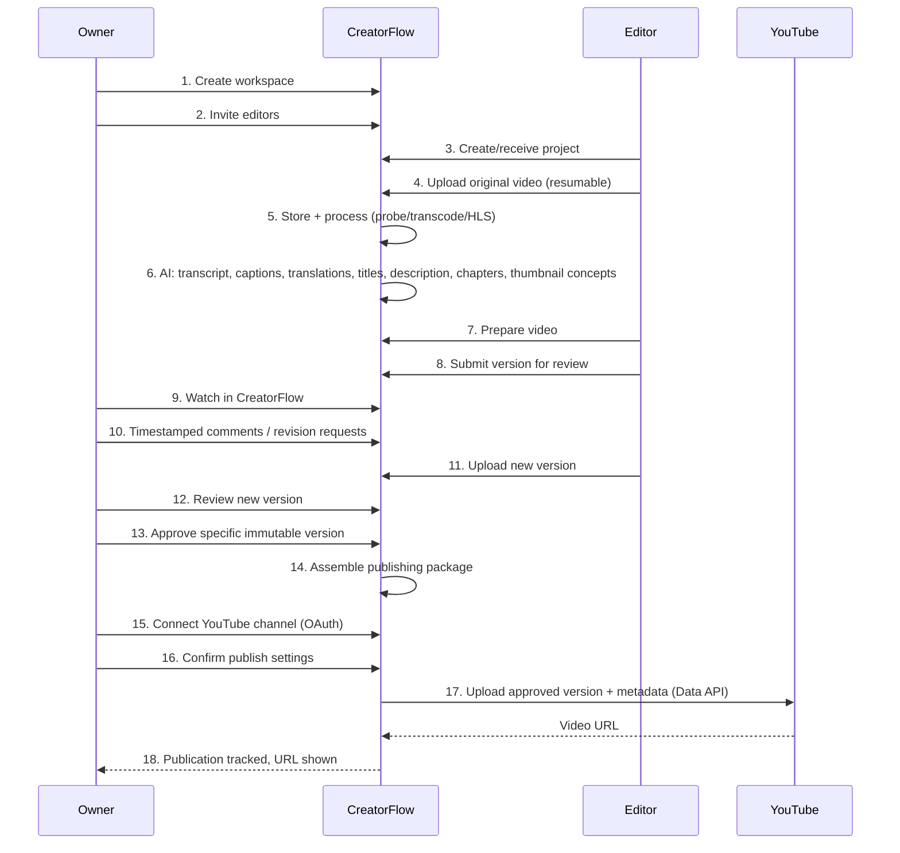
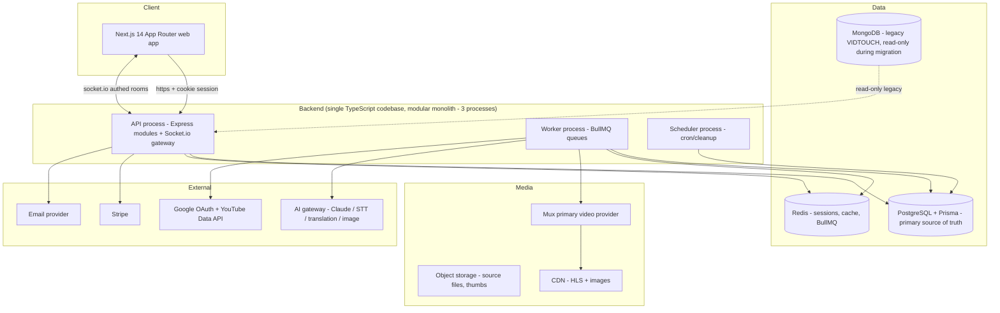

# CreatorFlow — Master Architecture

Status: **Proposed blueprint (planning only, no code changed)**
Scope: target architecture for transforming VIDTOUCH into CreatorFlow.
Revision: **2026-11-03/04 remediation sprint** — evidence base corrected (V11, V19, V21, V24 re-verified 2026-11-04), Findings A/B/C added, cross-document contradictions resolved, and all 13 documents present under `docs/architecture/` (the seven missing companions were created on 2026-11-04).

---

## 0. Evidence base and limitations

**Verified facts.** Everything in this section was re-verified directly against the current source tree in this session (file + line citations). No application code, package manifest, env file, or data was modified.

**Limitation — previous audit artifacts are not available.** The prompt references a prior repository audit, security findings, readiness reports, and an 86-item checklist. During the first drafting session of this document (before the 2026-11-03/04 remediation sprint) `docs/architecture/` contained **no documents at all** and no audit artifact existed anywhere in the repository or session; therefore all findings below were **re-derived from source inspection**. The directory is **no longer empty**: as of 2026-11-04 it holds all 13 CreatorFlow documents (see §7), each one verified to exist on disk. The workspace is **not a git repository** at either the repo root or the parent, so earlier revisions of these files are not recoverable — treat this file as the single current evidence baseline. The "86-item checklist" could not be revalidated item-by-item and is not cited.

**Limitation — no external verification.** Build status was checked with read-only `tsc --noEmit` runs. No services were started, no `next build` was run, no package was installed, no destructive testing was performed. Vendor pricing, API limits, and Google verification requirements are marked as assumptions where not verifiable from this environment.

### 0.1 Verified current-state findings (re-derived)

| # | Verified fact | Evidence |
|---|---|---|
| V1 | Hardcoded administrator e-mail authorization bypass in middleware | `server/middleware/auth.ts:47-50` (`ADMIN_EMAIL` bypasses `authorizeRoles("admin")`) |
| V2 | Social login trusts client-supplied identity (account takeover of any e-mail) | `server/controllers/user.controller.ts:260-285` (`socialAuth` accepts `{email,name,avatar}` from body, no provider verification) |
| V3 | Same hardcoded e-mail auto-promoted to `admin` from client code | `server/controllers/user.controller.ts:264-278`, `client/app/components/Navbar/Navbar.tsx:49-71` |
| V4 | Registration response returns `activeToken`; the signed JWT payload contains the **plaintext password** (JWT payloads are only base64, not encrypted) | `server/controllers/user.controller.ts:41-66`, `82-93` |
| V5 | Activation code is a 4-digit numeric code (`1000-9999`), 5-minute window | `server/controllers/user.controller.ts:83` |
| V6 | Access **and** refresh tokens returned in JSON response body | `server/utils/jwt.ts:47-52`; also `server/controllers/user.controller.ts:244-246` (`/auth/me` returns `accessToken`) |
| V7 | Redis session stores the full user document **including password hash** (login selects `+password` before `sendToken` writes it to Redis), and `/auth/me` serves it back | `server/controllers/user.controller.ts:140`, `server/utils/jwt.ts:36`, `server/controllers/user.controller.ts:239-246` |
| V8 | No rate limiting anywhere (no rate-limit dependency in `server/package.json`) | `server/package.json` |
| V9 | Socket.io broadcasts every `notification` event to **all** connected clients, no auth handshake | `server/socketServer.ts:9-14` |
| V10 | Mass assignment: `updateVideo` writes raw `req.body` via `$set`; `createVideo` passes raw body to `create` | `server/controllers/video.controller.ts:63-71`, `server/services/video.service.ts:6-8` |
| V11 | Unauthenticated VdoCipher OTP endpoint (playback credential for any video id) | `server/routes/video.route.ts:31` (no `isAuthenticated`), `server/controllers/video.controller.ts:491-511` |
| V12 | "Video upload" is base64 data-URI JSON (`express.json({limit:"50mb"})`) pushed to Cloudinary — no real upload pipeline, no type/size/content validation | `server/server.ts:24`, `server/controllers/video.controller.ts:17-36` |
| V13 | Server TypeScript build fails (`tsc` exit 2, 5 errors in `order.controller.ts`) | read-only `npx tsc --noEmit` in `server/`: `order.controller.ts:9,87,107,118,151` |
| V14 | Client TypeScript check fails (stale `.next/types`, `Set` iteration target, prop-type errors, plus server files leaking into client compile) | read-only `npx tsc --noEmit --incremental false` in `client/` |
| V15 | No test framework, no test scripts, no CI (`.github` absent) | `server/package.json`, `client/package.json`, no `.github/` |
| V16 | No AI, transcription, translation, thumbnail-generation, or YouTube Data API code exists | repo-wide dependency and source inspection |
| V17 | `app.ts` is entirely commented out (dead file); real entrypoint is `server.ts` | `server/app.ts:1-51`, `server/server.ts` |
| V18 | Secrets live in working-tree env files; `server/` has **no** `.gitignore` (client does) | `server/.env`, `client/.env`, `client/.gitignore`, absence of `server/.gitignore`. *Whether these are committed to a remote is unverified — no git repository exists at workspace root.* |
| V19 | Error middleware returns raw internal `err.message` to clients | `server/middleware/error.ts:33-36` (the normalisation branches at `:11` and `:13-31` build the message that is then leaked) |
| V20 | Admin route protection on the client is Redux-state only (server does enforce `authorizeRoles`, but client state is attacker-controllable) | `client/app/hooks/adminProtected.tsx:11-18` |
| V21 | Cron job registered at module import time inside a controller | `server/controllers/notification.controller.ts:56-61` |
| V22 | Redis keyspace shared between user sessions and video caches by raw id (`redis.get(videoId)` / `redis.get(decoded.id)`) | `server/controllers/video.controller.ts:87-99`, `server/middleware/auth.ts:29` |
| V23 | CORS hard-locked to `http://localhost:3000` in the API | `server/server.ts:27-32` |
| V24 | Existing stack confirmed: Next.js 14.1 App Router + Pages-API NextAuth shim, Express + TypeScript, Mongoose/MongoDB, Redis, Socket.io, Cloudinary, Stripe, VdoCipher, nodemailer/EJS | `client/package.json`, `server/package.json` — **clarified 2026-11-03**: VdoCipher is **not** an installed npm package; it is called over HTTP through Axios against `https://dev.vdocipher.com/api/videos/:id/otp` (`server/controllers/video.controller.ts:495-505`). Both `ioredis` (`server/package.json:32`) and `@upstash/redis` (`:23`) are installed, but **only `ioredis` is used** — `server/utils/redis.ts:1` imports `{ Redis } from "ioredis"`; the `@upstash/redis` dependency is currently unused and is a candidate for removal |

| V25 | Stripe PaymentIntent amount is taken from the client request body; the paid amount is never compared to the server-side price | `server/controllers/order.controller.ts:137` (`amount: req.body.amount`), `:25-31` (status-only check), `server/models/video.model.ts:37` (authoritative `price`) — **Finding A, P0** |
| V26 | Access/refresh token lifetimes are defined twice and disagree: JWT `exp` 7d/30d vs cookie `maxAge` **4 h / 58 days** (env values present, each var with a different unit — see Finding B) | `server/models/user.model.ts:97-99`, `:102-106`, `server/utils/jwt.ts:14-26` (`accessTokenExpire × 60×60×1000` = hours, `refreshTokenExpire × 24×60×60×1000` = days), `server/.env:22` (`ACCESS_TOKEN_EXPIRE = 4`), `server/.env:24` (`REFRESH_TOKEN_EXPIRE = 58`), `server/controllers/user.controller.ts:204-221` — **Finding B, P1** |
| V27 | Client source imports a server controller, pulling backend dependencies into the client TypeScript program | `client/redux/features/videos/videosApi.ts:1` (unused import of `server/controllers/video.controller`); confirmed by 10 `TS2339` errors reported under `../server/controllers/video.controller.ts` by the client typecheck — **Finding C, P1** |

**Not present (verified absence):** workspaces, memberships, invitations, projects, video versions, timestamped comments, approvals, transcripts/captions, AI provider code, YouTube integration, publishing, audit log, usage/quota/billing-for-CreatorFlow, design-system implementation, resumable upload, background worker process.

### 0.2 Newly discovered findings (added 2026-11-03)

| Finding | Severity | Status | Evidence | One-line defect |
|---|---|---|---|---|
| **A — Stripe payment manipulation** | **P0 / Critical** | **OPEN** | `server/controllers/order.controller.ts:137` | PaymentIntent `amount` is read from the client request body; the paid amount is never compared to the server-side price |
| **B — Authentication token lifetime mismatch** | **P1 / High** | **OPEN** | `server/models/user.model.ts:97-99`, `:102-106`, `server/utils/jwt.ts:14-26` | JWT `exp` and cookie `maxAge` are defined independently and disagree by two orders of magnitude |
| **C — Frontend/backend boundary violation** | **P1 / High** | **OPEN** | `client/redux/features/videos/videosApi.ts:1` | An unused import of a server controller pulls backend dependencies into the client TypeScript program |

**A, B and C are OPEN.** None is closed, mitigated, or partially mitigated in the current source. A proposed remediation is not a closed finding. Each stays OPEN until the source is changed *and* its regression test — specified in `SECURITY_AND_THREAT_MODEL.md` §4 — passes independently of the author of the fix. Full registers: SEC-07 (A), SEC-03 (B), and `TESTING_AND_QUALITY_STRATEGY.md` §5 (C).

**Finding A — financial impact.** `newPayment` calls `stripe.paymentIntents.create` with `amount: req.body.amount` and a hardcoded `currency: "inr"` (`order.controller.ts:137-138`). The authoritative price is `video.price` (`server/models/video.model.ts:37`) — already used for the confirmation email (`order.controller.ts:63`) but never consulted for payment. `createOrder` verifies only `paymentIntent.status === "succeeded"` (`order.controller.ts:25-31`) and never compares `paymentIntent.amount` to the expected price, so a client can create a 1-paise intent, pay it, and obtain the full-price video. The defect is not only "the amount is client-supplied" but "**nothing downstream reconciles what was paid against what was owed**". The trusted pricing model, currency validation, order validation, idempotency rule and regression tests are specified in `SECURITY_AND_THREAT_MODEL.md` SEC-07.

**Finding B — lifetime impact (re-verified 2026-11-04).** The access JWT expires in 7 days (`user.model.ts:97-99`); the access cookie's `maxAge` is `ACCESS_TOKEN_EXPIRE × 60×60×1000` ms (`jwt.ts:14-19` — the code treats the value as **hours**, although the name reads like minutes) and `server/.env:22` sets `ACCESS_TOKEN_EXPIRE = 4`, so the cookie lives **4 hours**. The refresh JWT expires in 30 days (`user.model.ts:102-106`); the refresh cookie's `maxAge` is `REFRESH_TOKEN_EXPIRE × 24×60×60×1000` ms (`jwt.ts:15-26` — **days**) and `server/.env:24` sets `REFRESH_TOKEN_EXPIRE = 58`, so the cookie lives **58 days** — two env vars with near-identical names carrying different units, and neither matching its JWT. Three defects compound it: `redis.set(user._id, JSON.stringify(user))` (`jwt.ts:36`) sets **no TTL**, `user.controller.ts:221` sets `EX 604800` (7 days) on the refresh path, and `order.controller.ts:91` again writes with **no TTL** after a purchase — three writers, three behaviours; and `generateAccessToken` is mounted as per-request middleware on nine routes (`server/routes/video.route.ts:8,10,17,19,21,23,25,27,29`), so every authenticated video request re-signs tokens and slides the session forward. Net effect: a 7-day bearer token that is also returned in the JSON body (`jwt.ts:50`), with no server-side revocation path — logout deletes the Redis key (`user.controller.ts:160-176`) but cannot invalidate an already-issued JWT. The required single-source-of-truth configuration is specified in `SECURITY_AND_THREAT_MODEL.md` SEC-03 (inventory table + rules); regression tests B-1…B-7 in `SECURITY_AND_THREAT_MODEL.md` §4.2.

**Finding C — boundary impact.** `client/redux/features/videos/videosApi.ts:1` imports `addReplyToReview` from `../../../../server/controllers/video.controller`. The symbol is **never used** — the file defines its own same-named RTK Query mutation at `videosApi.ts:88` — so this dead import still pulls `server/controllers/video.controller.ts` (and through it `mongoose`, `cloudinary`, `ejs`, `express`, `axios`, `../utils/redis`, `../utils/sendMail`) into the client program. `client/tsconfig.json:24` includes `**/*.ts`, so the out-of-root file is compiled as part of the client project: the client typecheck reports 10 `TS2339` errors under `../server/controllers/video.controller.ts` (lines 164, 210, 218, 271, 281, 283, 331, 344, 362, 364). The import-boundary rule and its regression test are specified in `TESTING_AND_QUALITY_STRATEGY.md` §5.

---

## 1. The CreatorFlow product (definition of target)

Premium, AI-powered YouTube video production, collaboration and publishing SaaS.

### 1.1 End-to-end workflow (normative)

### 1.2 Essential modules (must all exist in the target)

Workspace management · Team & permissions · Project management · Asset/video library · Resumable uploads · Video processing & playback · Immutable version management · Timestamped review comments · Revisions · Owner approval · Transcript & caption editor · Translation · AI content intelligence · SEO assistance · Thumbnail Studio · YouTube channel connections · Publishing Studio · Publishing calendar · Notifications · Activity/audit history · Usage, quotas & billing · Platform administration.

The product **must not** collapse into "a dashboard with AI buttons": versioning, timestamped review, approval of an immutable version, and gated publishing are the load-bearing differentiators.

---

## 2. Target architecture — recommendations at a glance

### 2.1 Subsystem recommendations (with the alternatives examined)

| Subsystem | Alternatives examined | **Recommendation** | Why (smallest robust option) |
|---|---|---|---|
| Application | (a) Next.js API routes; (b) existing separate Next.js + Express; (c) modular monolith + background worker; (d) microservices | **(c) modular monolith**: one TypeScript backend codebase, three processes (API, worker, scheduler), Next.js frontend kept separate | Video/AI/publish jobs are long-running and cannot live in request lambdas (a). Replacing Express now buys nothing (b). Microservices (d) add network, deployment and consistency cost with zero product need. Reuses existing Express structure. |
| Database | (a) PostgreSQL + Prisma/Drizzle; (b) MongoDB + Mongoose (status quo); (c) staged migration | **PostgreSQL + Prisma as primary source of truth for all CreatorFlow data**; MongoDB retained read-only for legacy marketplace until separately planned migration (c as transition, a as destination) | Versions, approvals, comments and audit need referential integrity, immutability enforcement and multi-row transactions. See ADR-002. |
| Authentication | (a) managed auth (Clerk/Auth0/etc.); (b) Auth.js/NextAuth; (c) existing custom JWT + Redis sessions | **Rebuilt server-side session auth inside the API**: opaque session ids in `httpOnly; Secure; SameSite=Lax` cookies, sessions in Redis + Postgres record, Google OIDC verified **server-side**, Argon2id passwords. Managed auth remains an **open decision (D1)** | (c) as-is is insecure (V1–V7). (b) NextAuth sessions are not verified by the Express API and the current shim is a trust hole (V2). A managed provider is viable but adds vendor cost/lock-in — needs your approval. |
| Video infrastructure | (a) Mux; (b) Cloudflare Stream; (c) S3-compatible + FFmpeg workers + CDN | **Mux primary behind a `VideoProvider` port; Cloudflare Stream as fallback; S3 + FFmpeg as escape hatch** | Mux removes transcoding/HLS/duration/thumbnail operations entirely (smallest code). Port keeps a swap path (ADR-003). |
| Background processing | (a) BullMQ + Redis; (b) managed queue (SQS/Cloud Tasks); (c) cron-only | **BullMQ on the existing Redis** | Redis already exists (Upstash/ioredis, `server/utils/redis.ts`); managed queue adds an account+network hop for no gain at this scale. |
| AI | single provider hard-wired vs provider-independent layer | **Provider-independent AI gateway** with adapters per capability (STT, translation, LLM, image), zod-validated structured outputs, prompt versioning, per-job cost accounting | No AI integration exists today (V16); building the port first prevents provider lock-in from day one. |
| YouTube | in-request upload vs worker-driven publish | **Worker-driven, idempotent publish jobs** with encrypted refresh tokens and quota accounting | Uploads take minutes and can fail mid-flight; request path is wrong place. |
| Realtime | existing Socket.io vs SSE vs polling | **Socket.io retained, reworked**: authenticated handshake; canonical room names `ws:{workspaceId}`, `ws:{workspaceId}:prj:{projectId}`, `ws:{workspaceId}:ver:{versionId}` | Existing dependency; current broadcast model is broken (V9) and must be replaced regardless. Every room carries the workspace prefix so a tenant can never be inferred from the room name alone. Canonical names are normative in `API_CONTRACT_AND_MODULES.md` §3.15 and `SYSTEM_COMPONENT_ARCHITECTURE.md` §4.3; the earlier `workspace:*/project:*` notation was ambiguous and is retired. |

---

## 3. Quality attributes (driving constraints)

1. **Tenant isolation**: every query scoped by `workspace_id`; cross-workspace access is a bug class tested explicitly.
2. **Immutability**: a `VideoVersion`'s media and metadata are never mutated after `ready`; comments and approvals reference exact version ids.
3. **Recoverability**: every async job is idempotent, retryable, and observable (queue lag, dead-letter).
4. **Security**: no identity from the client, no secrets in responses, least-privilege RBAC, append-only audit.
5. **Cost control**: per-workspace storage/quota, AI spend caps, video provider minute tracking.
6. **Evolvability**: monolith with hard module boundaries so a module can be extracted later only if evidence demands it.

---

## 4. Open decisions requiring your approval

| ID | Decision | Options | Recommendation |
|---|---|---|---|
| D1 | Auth strategy | Self-hosted sessions in API (recommended) vs managed auth (Clerk/Auth0) | Self-hosted; revisit if schedule pressure grows |
| D2 | Video provider | Mux (recommended) vs Cloudflare Stream vs S3+FFmpeg | Mux — approve budget before Phase 4 |
| D3 | Primary LLM/STT vendors & budget | Anthropic Claude + OpenAI/Deepgram (recommended candidates) vs others | Approve vendors and monthly spend cap |
| D4 | PostgreSQL ORM | Prisma (recommended) vs Drizzle | Prisma |
| D5 | Legacy marketplace fate | Archive (read-only) vs isolate vs remove | Archive read-only until CreatorFlow launches (ADR-014) |
| D6 | Keep Express or move API into Next.js route handlers | Keep Express (recommended) | Keep |
| D7 | Monorepo layout | Keep `client/` + `server/` siblings (recommended) vs `apps/*` | Keep current layout, add `worker/` entry inside `server/` |
| D8 | Google Cloud project & YouTube API quota | New project per environment | New project; verification lead time is a long pole (§5) |
| D9 | Stripe scope for CreatorFlow | Per-workspace subscription plans vs usage-based | Start with seat/workspace plans; usage metering recorded but not billed (Phase 10) |
| D10 | Data residency / compliance needs | None stated | Assume none unless you say otherwise |

Eight further open items were identified by the 2026-11-03 validation and are registered as **OD-01…OD-08** in `ARCHITECTURE_DECISION_RECORDS.md` §5 — four are RESOLVED by this remediation sprint, four remain OPEN.

**Silent choices were not made**: D1–D10 are all listed here and repeated in the relevant subsystem documents.

---

## 5. External dependencies (longest lead times first)

1. **Google OAuth consent verification** for YouTube upload scopes (`youtube.upload` is a *restricted/sensitive* scope) — weeks; **start the verification request in Phase 0** because the lead time gates Phase 9 (see `YOUTUBE_PUBLISHING_ARCHITECTURE.md` §3, `MIGRATION_AND_IMPLEMENTATION_ROADMAP.md` Phase 0 and Phase 9).
2. **Video provider account approval & pricing** (Mux or Cloudflare) — days to weeks; Phase 4 pre-work.
3. **AI provider credentials & rate limits** (LLM + speech-to-text) — days; Phase 6/7 pre-work.
4. **Email deliverability** (domain auth: SPF/DKIM/DMARC) — days; Phase 0 pre-work.
5. **Stripe account for production billing** — days; Phase 10.
6. **CDN + object storage accounts** — days; Phase 4.

None of these require code changes to *start* — account and verification work is scheduled in Phase 0, because every one of them has a lead time longer than the phase that consumes it.

---

## 6. P0 before any feature development

Summarized here; full remediation plan in `SECURITY_AND_THREAT_MODEL.md`.

1. Remove hardcoded admin e-mail bypass (V1, V3) — `server/middleware/auth.ts:47-50`, `user.controller.ts:264-278`, `Navbar.tsx:49-71`.
2. Stop trusting client identity in `socialAuth` — replace with server-side OIDC verification (V2).
3. Stop returning tokens/password material in bodies and Redis sessions (V4, V6, V7).
4. Fix activation flow: random 32-byte tokens, no password inside tokens (V4, V5).
5. Authenticate + scope Socket.io (V9); lock down VdoCipher OTP endpoint (V11); validate upload payloads (V12).
6. Fix the broken TypeScript builds (V13, V14) and add CI that runs `tsc --noEmit` + lint + tests (V15).
7. Add rate limiting on auth and upload endpoints (V8); stop leaking internal error messages (V19).
8. Secret hygiene: `server/.gitignore`, rotate any exposed credentials, never print env values (V18).
9. **Stripe payment manipulation (V25 / Finding A, P0)** — derive the PaymentIntent amount from the server-side `video.price` in minor units and reconcile the paid amount and currency against that price when the order is created. Evidence: `server/controllers/order.controller.ts:137`, `:25-31`.
10. **Token lifetime mismatch (V26 / Finding B, P1)** — one TTL source of truth; cookie `maxAge` must equal JWT `exp`; refresh capped at ≤30 days; session TTL bound to the refresh TTL; stop sliding the session on every request; revoke access tokens on logout. Evidence: `server/models/user.model.ts:97-99`, `server/utils/jwt.ts:14-26`.
11. **Client/server boundary violation (V27 / Finding C, P1)** — remove `client/redux/features/videos/videosApi.ts:1` and enforce the import boundary in lint and CI. Evidence: `client/redux/features/videos/videosApi.ts:1`.

Items 9–11 remain **OPEN** — see `SECURITY_AND_THREAT_MODEL.md` SEC-07, SEC-03 and §4 respectively. A proposed remediation is not a closed finding.

---

## 7. Document map

All 13 documents exist on disk as of 2026-11-04 (six were updated and seven were created by the remediation sprint). Where a subsystem document and this file appear to disagree, the rule stated here is canonical and the subsystem document is authoritative for its own detail. Every `ADR-nnn` and `OD-nn` reference resolves to `ARCHITECTURE_DECISION_RECORDS.md`; every `SEC-nn` reference resolves to `SECURITY_AND_THREAT_MODEL.md`.

| # | Document | Contents |
|---|---|---|
| 1 | `CREATORFLOW_MASTER_ARCHITECTURE.md` | this file |
| 2 | `SYSTEM_COMPONENT_ARCHITECTURE.md` | components, processes, boundaries, module layout |
| 3 | `DATABASE_SCHEMA_AND_ERD.md` | full entity model + ER diagrams |
| 4 | `API_CONTRACT_AND_MODULES.md` | endpoints, conventions, roles |
| 5 | `VIDEO_PROCESSING_ARCHITECTURE.md` | upload, processing, playback, provider choice |
| 6 | `AI_PROVIDER_ARCHITECTURE.md` | provider-independent AI layer |
| 7 | `YOUTUBE_PUBLISHING_ARCHITECTURE.md` | OAuth, tokens, publish pipeline |
| 8 | `SECURITY_AND_THREAT_MODEL.md` | P0 remediation, threat model, acceptance checklist |
| 9 | `FRONTEND_DESIGN_SYSTEM.md` | routing, design system, 27 screens, component trees |
| 10 | `INFRASTRUCTURE_AND_DEPLOYMENT.md` | environments, topology, observability, setup tasks |
| 11 | `TESTING_AND_QUALITY_STRATEGY.md` | test layers + E2E acceptance journey |
| 12 | `MIGRATION_AND_IMPLEMENTATION_ROADMAP.md` | KEEP/REFACTOR map, 13 phases |
| 13 | `ARCHITECTURE_DECISION_RECORDS.md` | ADR-001…ADR-016 |

**Convention used across all documents:**
- **Verified** = inspected in this repository (file:line given).
- **Proposed** = target design, not yet implemented.
- **Recommended** = our choice among real alternatives.
- **Open** = needs your decision (D1–D10).
- **Assumption** = not verifiable from this environment (vendor limits, pricing, quota numbers).
