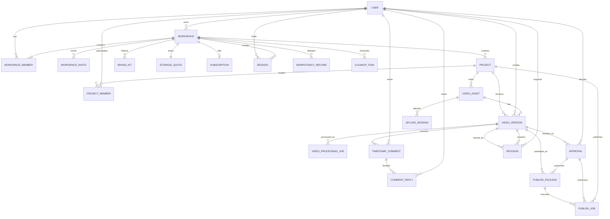
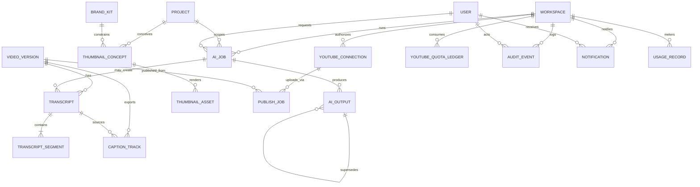

# CreatorFlow — Database Schema & ERD

Status: **Proposed** (PostgreSQL + Prisma, ADR-002). No schema was created or migrated — planning only.

---

## 1. Conventions (apply to every entity)

| Rule | Detail |
|---|---|
| Primary key | `id uuid PRIMARY KEY DEFAULT gen_random_uuid()` |
| Tenant key | Every workspace-owned row carries `workspace_id uuid NOT NULL` → `workspace(id)`; **all** queries in the data layer append `WHERE workspace_id = $ctx` (application-enforced isolation + optional RLS as defense-in-depth) |
| Timestamps | `created_at timestamptz NOT NULL DEFAULT now()`, `updated_at timestamptz NOT NULL DEFAULT now()` maintained by the service layer **on every row that has an `updated_at` column**. Every mutable entity carries `updated_at`; immutable entities carry `created_at` only. `video_version` is mutable in exactly three business columns (§2.3) and therefore carries `updated_at` |
| Enums | Postgres `TEXT` + CHECK or native enums; states listed in §3 of this file and state-machine doc |
| Money | integer minor units + `currency char(3)` |
| Soft delete | `deleted_at timestamptz NULL` only where listed; everything else hard-deletes via lifecycle rules |
| JSONB | used only for provider payloads/outputs, never for relational data |
| Immutability | `video_version` rows are append-only: service layer forbids UPDATE except `review_state`/`processing_state` columns listed as mutable; media bytes never change after `ready` |

### 1.1 Shared constraints

- **Cross-tenant references are rejected at the DB level**, not merely by application code. Every tenant-owned child table carries `workspace_id` and references its parent through a **composite foreign key that includes `workspace_id`**:
  - project-scoped children → `FOREIGN KEY (workspace_id, project_id) REFERENCES project(workspace_id, id)`
  - version-scoped children (`timestamp_comment`, `transcript`, `caption_track`, `ai_job`, `approval`, `publish_package`, `publish_job`, `video_processing_job`) → `FOREIGN KEY (workspace_id, version_id) REFERENCES video_version(workspace_id, id)`
  - asset-scoped children (`upload_session`, `video_processing_job`) → `FOREIGN KEY (workspace_id, asset_id) REFERENCES video_asset(workspace_id, id)`

  Each referenced parent therefore carries a matching `UNIQUE(workspace_id, id)` (the parent id is already unique, so the composite unique is additive and cheap).

  **Consequence:** a row can no longer reference a parent in another workspace — not through a service bug, not through a raw SQL writer, not through a future console script. This closes the isolation gap that single-column FKs left open, and it makes the workspace-isolation acceptance tests in `TESTING_AND_QUALITY_STRATEGY.md` §3 assert a database property rather than an application convention.
- Every unique constraint that includes tenant scope includes `workspace_id`.
- `audit_event` is **append-only**: no UPDATE/DELETE granted to the application DB role (role has INSERT/SELECT only on that table).
- Database-level guarantees that Prisma cannot express — **constraint triggers, partial unique indexes, row-level security** — are created as hand-written SQL inside `prisma/migrations/<n>_*/migration.sql`. These migrations are part of the schema contract, not optional extras, and are covered by the acceptance tests in §7.

---

## 2. Entity specifications

### 2.1 Identity & tenancy

**`user`** — global person account (platform-level, not tenant-owned).
- Fields: `id`, `email citext UNIQUE NOT NULL`, `name`, `password_hash` (Argon2id, `NULL` for OIDC-only), `email_verified_at`, `avatar_url`, `status` (`active|suspended|deleted`), `is_platform_admin bool DEFAULT false`, `last_login_at`, `created_at`, `updated_at`, `deleted_at`.
- PK `id`. No tenant isolation (global). Index: `UNIQUE(email)`, `idx_user_status`.
- Retention: soft-delete; hard-delete after 30-day grace via `scheduler` cascade request (see §4).
- Verified precedent: current `server/models/user.model.ts:24-77` (role, `select:false` password, `isVerified`) — replaced, role becomes workspace-scoped (hardcoded admin email removed, `server/middleware/auth.ts:47-50`).

**`workspace`** — tenant root.
- Fields: `id`, `name`, `slug UNIQUE`, `owner_user_id → user.id`, `plan` (`free|pro|team`), `status` (`active|suspended|archived`), `settings jsonb`, `created_at`, `updated_at`, `deleted_at`.
- Index: `UNIQUE(slug)`, `idx_ws_owner`.
- Isolation root: every other tenant table hangs off `workspace_id`.
- Retention: archive on delete; data retained 90 days, then purge job.

**`workspace_member`** — membership + role (RBAC subject).
- Fields: `id`, `workspace_id`, `user_id`, `role` (`owner|admin|editor|viewer`), `status` (`active|invited|suspended`), `invited_by`, `joined_at`, timestamps.
- Constraints: `UNIQUE(workspace_id, user_id)`; CHECK `role IN (...)`; exactly one `owner` enforced in service layer (and partial unique index `ON workspace(workspace_id) WHERE role='owner'` via generated column trick or service invariant).
- Index: `idx_member_user(user_id)`, `idx_member_ws(workspace_id, role)`.
- Retention: removed on workspace delete or member removal (audit event written).

**`workspace_invite`** — pending invitation.
- Fields: `id`, `workspace_id`, `email citext`, `role`, `token_hash` (only hash stored), `invited_by`, `expires_at`, `accepted_at`, `revoked_at`, `created_at`.
- Constraints: `UNIQUE(workspace_id, email)` among unaccepted (partial index `WHERE accepted_at IS NULL AND revoked_at IS NULL`); `expires_at = created_at + interval '7 days'`.
- Token: 32 random bytes, hash stored, single-use (fixes weak 4-digit code pattern, verified `user.controller.ts:83`).
- Retention: purge expired invites after 30 days.

**`session`** — server-side session record (the authoritative store; Redis is a cache in front of it).
- Fields: `id` (sha256 of the opaque cookie token — **the raw token is never stored**), `user_id → user.id`, `workspace_id NULL` (set only for workspace-scoped sessions), `created_at`, `last_seen_at`, `expires_at`, `revoked_at NULL`, `revoked_reason`, `ip inet`, `user_agent`, `rotated_from_session_id NULL` (link to the session it replaced during rotation), `rotated_at NULL`.
- Constraints: `UNIQUE(id)`; CHECK `expires_at > created_at`; CHECK `revoked_at IS NULL OR revoked_at >= created_at`.
- Index: `idx_session_user(user_id, expires_at DESC) WHERE revoked_at IS NULL`, `idx_session_expiry(expires_at) WHERE revoked_at IS NULL`.
- **Redis role (resolved):** Redis caches the session payload under a **namespaced** key `sess:{sha256(token)}` with a TTL equal to `expires_at - now()`. It is a cache, never the only copy: revocation writes `revoked_at` in Postgres **first**, then deletes the cache key. A Redis flush cannot resurrect a revoked session. This also removes the shared-keyspace defect recorded as V22 (`server/controllers/video.controller.ts:87-99` and `server/middleware/auth.ts:29` both used bare ids in one namespace).
- **Rotation:** the session id rotates on privilege change (password change, email change, role change) and on "sign out everywhere". The superseded row keeps `revoked_at` for audit.
- **Lifetime:** `expires_at` is derived from the **single** TTL configuration defined in `SECURITY_AND_THREAT_MODEL.md` SEC-03 — never from a second, independent constant.
- Retention: revoked rows retained 90 days for incident investigation, then purged by the scheduler.
- Verified precedent (replaced): the current implementation stores the **entire user document, including the password hash**, in Redis under the bare user id (`server/utils/jwt.ts:36`, populated by `server/controllers/user.controller.ts:140`) and serves it back from `/auth/me` (`server/controllers/user.controller.ts:239-246`) — see V7. That model is replaced by this table: a session stores an id, never a user document.

**`idempotency_record`** — replay protection for mutating API requests.
- Fields: `id`, `workspace_id`, `endpoint` (method + path template), `idempotency_key`, `request_hash` (sha256 of the canonicalised request body), `state` (`in_progress|completed`), `response_status NULL`, `response_body jsonb NULL`, `resource_type NULL`, `resource_id NULL`, `expires_at`, `created_at`, `completed_at NULL`.
- Constraints: `UNIQUE(workspace_id, endpoint, idempotency_key)`; CHECK `state='in_progress'` ⇒ `response_status IS NULL`.
- Index: `idx_idem_expiry(expires_at)`.
- **Semantics:** same key + same `request_hash` inside the window → replay the stored response; same key + **different** `request_hash` → `409 IDEMPOTENCY_MISMATCH`; `state='in_progress'` → `409 IDEMPOTENCY_IN_PROGRESS` (the client retries with backoff; it must not issue a second write).
- **Window:** 24 hours, matching `API_CONTRACT_AND_MODULES.md` §1.5.
- **Interaction with job-level keys (resolved):** job tables carry their own permanent `idempotency_key UNIQUE` (`ai_job`, `video_processing_job`, `publish_job`). Those keys are **derived from stable business facts** (`task:version:target:paramsHash`; `workspace:version:channel`) — never from the request header — and they are **not** windowed. Resolution: the API layer checks the **derived job key first**; if a job already exists for that derived key, the API returns that job's identity and the existing resource instead of creating a second one. The 24-hour `idempotency_record` window therefore cannot allow a second job for the same business fact, and a permanent job key cannot reject a legitimate second request after the window has expired.
- Retention: purged 30 days after `expires_at`.

### 2.2 Projects

**`project`** — a video production unit.
- Fields: `id`, `workspace_id`, `key` (e.g. `PRJ-014`), `title`, `description`, `status` (`active|archived`), `review_state` (`draft|submitted|under_review|changes_requested|approved`) — *project-level roll-up of latest version review state*, `created_by`, timestamps, `deleted_at`.
- Constraints: `UNIQUE(workspace_id, key)`; composite FK `(workspace_id, id)` referenced by children.
- Index: `idx_project_ws_status(workspace_id, status, updated_at DESC)`.
- Retention: archived then purged with workspace.

**`project_member`** — per-project overrides (default = workspace membership).
- Fields: `id`, `workspace_id`, `project_id`, `user_id`, `role` (`editor|viewer`), timestamps. `UNIQUE(project_id, user_id)`.
- Index: `idx_pm_user(user_id)`, `idx_pm_project(project_id)`.

**`revision`** — an explicit change-request link between two versions.
- Fields: `id`, `workspace_id`, `project_id`, `from_version_id` (the version that was reviewed), `to_version_id` (the version created in response — NULL while the revision is still open), `requested_by`, `requested_at`, `note`, `status` (`open|addressed|superseded`), `source_comment_id NULL` (the originating timestamped comment, when the revision arose from one), `created_at`, `updated_at`.
- Constraints: FK `(workspace_id, from_version_id) → video_version(workspace_id, id)`; FK `(workspace_id, to_version_id) → video_version(workspace_id, id)` (nullable); CHECK `to_version_id IS NULL OR to_version_id <> from_version_id`; partial unique index `ON revision(project_id, from_version_id) WHERE status='open'` — at most one open revision per reviewed version.
- Index: `idx_revision_project(project_id, requested_at DESC)`, `idx_revision_to(to_version_id)`.
- **Semantics (resolved):** a revision is **not** a review-state transition. Requesting changes moves the version to `changes_requested`; the revision row records *what* was asked for and *which* new version answers it. `timestamp_comment.kind='change_request'` remains the discussion artifact; `revision` is the version-to-version link. Both may point at the same originating comment.
- Retention: follows project; a revision is never hard-deleted while either of its versions is referenced by an approval or a publish job.

### 2.3 Assets, versions, processing

**`upload_session`** — resumable upload bookkeeping (supports idempotency).
- Fields: `id`, `workspace_id`, `project_id`, `asset_id (nullable until created)`, `filename`, `byte_size`, `checksum_sha256`, `mime_type`, `storage_target` (`provider|s3`), `provider_upload_id`, `bytes_received`, `status` (`pending|uploading|completed|aborted|expired`), `expires_at`, `created_by`, timestamps.
- Constraints: `UNIQUE(workspace_id, checksum_sha256)` active-session dedupe (partial index where status in pending/uploading); `expires_at ≤ created_at + 48h`.
- Index: `idx_upload_expiry(expires_at)` for the cleanup queue.

**`video_asset`** — the original uploaded media (library item).
- Fields: `id`, `workspace_id`, `project_id`, `title`, `source_storage_key`, `byte_size`, `mime_type`, `checksum_sha256`, `duration_seconds` (nullable until probed), `width`, `height`, `originally_uploaded_by`, `processing_state` (`uploaded|queued|probing|processing|ready|failed`), `provider` (`mux|cloudflare|s3`), `provider_asset_id`, `deleted_at`, timestamps.
- Constraints: `UNIQUE(workspace_id, checksum_sha256)` (dedupe), CHECK `byte_size > 0`.
- Index: `idx_asset_ws_project(workspace_id, project_id, created_at DESC)`, `idx_asset_state(processing_state) WHERE deleted_at IS NULL`.
- Verified precedent: no equivalent exists today — current "upload" is base64→Cloudinary (`video.controller.ts:17-36`), replaced.
- Retention: source file kept until `workspace.settings.keep_sources=false` or quota purge; derivatives follow lifecycle rules §4.

**`video_version`** — **immutable** cut of an asset submitted through review.
- Fields: `id`, `workspace_id`, `project_id`, `asset_id`, `version_number int` (1..n), `label`, `storage_key` (version file if re-cut, else same as asset), `processing_state` (`uploaded|queued|probing|processing|ready|failed`), `duration_seconds`, `provider` (`mux|cloudflare|s3` — **added**: the version records its own provider so the provider is never inferred through the asset), `provider_asset_id`, `playback_ids jsonb`, `review_state` (`draft|submitted|under_review|changes_requested|approved`), `submitted_by`, `submitted_at`, `ready_at`, `checksum_sha256`, `created_by`, `created_at`, `updated_at`.
- Constraints: `UNIQUE(project_id, version_number)`; `UNIQUE(workspace_id, id)`; CHECK `version_number > 0`.
- **Mutable columns only:** `review_state`, `submitted_at`, `submitted_by`, `updated_at`. Everything else immutable (DB trigger `video_version_media_immutable` rejects UPDATE of media columns; service forbids delete while referenced by approval/publish).
- **`updated_at` (added — resolves the stale-approval defect):** the earlier draft omitted `updated_at` from this entity while §2.4's optimistic-concurrency rule compared `expected_updated_at` against "the version's `updated_at`", leaving the guard unimplementable — there was no such column. `updated_at` is now an explicit column, updated by the service layer in the **same transaction** as any change to `review_state`, `submitted_at` or `submitted_by`. The stale-approval check compares `expected_updated_at` against this column.
- Index: `idx_version_project(project_id, version_number DESC)`, `idx_version_state(workspace_id, review_state)`.
- Retention: never deleted while an `approval` or `publish_job` references it (FK `RESTRICT`); otherwise follows project retention.

**`video_processing_job`** — one stage execution record (probe / transcode / thumbnail / audio).
- Fields: `id`, `workspace_id`, `version_id`, `asset_id`, `stage` (`provider_asset|probe|transcode|thumbnail|audio|validate`), `state` (`queued|running|succeeded|failed|dead`), `attempt int` (see attempt semantics below), `max_attempts int`, `idempotency_key UNIQUE`, `provider_job_ref`, `error_code`, `started_at`, `finished_at`, `next_retry_at`, `created_at`.
- Index: `idx_vpj_version(version_id, stage, created_at DESC)`, `idx_vpj_state(state)` for lag metrics.
- **`stage` enumeration (resolved):** the queue table in `VIDEO_PROCESSING_ARCHITECTURE.md` §4 lists seven queues. `asset.process` (provider-asset creation) had no matching stage value, so the value **`provider_asset`** was added; the remaining five map 1:1 to `probe`, `transcode`, `thumbnail`, `audio`, `validate`. `lifecycle.cleanup` is **not** a `video_processing_job` — cleanup targets assets, uploads, projects and workspaces rather than versions, so it is tracked in `cleanup_task` (§2.3.1) and is deliberately outside this table.
- **Attempt semantics (canonical):** `attempt` counts attempts already started, starting at 1. A job is terminal-failed and dead-lettered when `attempt >= max_attempts`. `max_attempts` includes the first attempt, so `max_attempts = 4` means 1 initial attempt + 3 retries. Video stages use `max_attempts = 4`; AI jobs use `max_attempts = 4`; publish jobs use `max_attempts = 5`. The canonical table is `API_CONTRACT_AND_MODULES.md` §5.6.
- Retention: 180 days after terminal state.

### 2.3.1 Cleanup tasks

**`cleanup_task`** — deferred deletion/retention work that is not tied to a version.
- Fields: `id`, `workspace_id NULL` (NULL for platform-wide sweeps), `subject_type` (`upload_session|video_asset|video_version|project|workspace|notification|audit_event|ai_output|idempotency_record|session|workspace_invite|usage_record|billing_webhook_event`), `subject_id`, `action` (`purge|expire|archive`), `due_at`, `state` (`pending|running|succeeded|failed`), `attempt int`, `max_attempts int`, `last_error_code NULL`, `created_at`, `finished_at NULL`.
- Constraints: partial unique index `ON cleanup_task(subject_type, subject_id, action) WHERE state='pending'` — one pending cleanup per subject and action.
- Index: `idx_cleanup_due(due_at) WHERE state='pending'`.
- **Rationale (resolved):** `VIDEO_PROCESSING_ARCHITECTURE.md` §4 lists a `lifecycle.cleanup` queue whose jobs are not version-scoped (they sweep expired uploads, deleted projects, archived workspaces, old audit rows). Modelling them as `video_processing_job` rows would have forced a bogus `version_id` on them. `cleanup_task` is the row that records the **intent**; the queue carries the execution.
- Retention: succeeded rows kept 90 days for audit, then purged.

### 2.4 Review

**`timestamp_comment`** — comment pinned to an exact version + time.
- Fields: `id`, `workspace_id`, `project_id`, `version_id NOT NULL`, `author_user_id`, `time_seconds numeric(10,3)`, `end_seconds numeric(10,3) NULL` (range comments), `body text NOT NULL`, `kind` (`comment|change_request`), `status` (`open|resolved`), `resolved_by`, `resolved_at`, `parent_comment_id NULL` (thread root), `deleted_at`, timestamps.
- Constraints: FK `version_id → video_version(id)` (**required** — comments always reference exact version, per product spec); CHECK `time_seconds >= 0`; CHECK `end_seconds IS NULL OR end_seconds > time_seconds`.
- Index: `idx_tc_version_time(version_id, time_seconds)`, `idx_tc_ws_status(workspace_id, status)`.
- Retention: follows version; soft-delete preserves thread integrity.

**`comment_reply`** — reply inside a thread.
- Fields: `id`, `workspace_id`, `comment_id`, `author_user_id`, `body`, `deleted_at`, timestamps. FK `comment_id → timestamp_comment(id) ON DELETE CASCADE`. Index `idx_reply_comment(comment_id, created_at)`.

**`approval`** — owner's decision on one immutable version.
- Fields: `id`, `workspace_id`, `project_id`, `version_id NOT NULL`, `decided_by`, `decision` (`approved|changes_requested`), `note`, `expected_updated_at timestamptz` (optimistic-concurrency echo), `decided_at`, `created_at`, `updated_at`.
- Constraints: `UNIQUE(version_id)` where `decision='approved'` (partial) — **a version can be approved at most once**; FK `(workspace_id, version_id) → video_version(workspace_id, id) ON DELETE RESTRICT`; CHECK `decision IN ('approved','changes_requested')`.
- Index: `idx_approval_project(project_id, decided_at DESC)`, `idx_approval_ws(workspace_id, decided_at DESC)`.
- **Decision ↔ review-state mapping (resolved):** `approval.decision` uses exactly the two values that the `video_version.review_state` machine can actually reach as a decision: `approved` and `changes_requested`. The earlier draft used `approved|rejected`, while the review state machine used `changes_requested` — `rejected` was therefore unmapped and un-actionable: no endpoint could produce it and no transition consumed it. Resolution: the request-changes endpoint writes an `approval` row with `decision='changes_requested'` **and** moves the version's `review_state` to `changes_requested` in the same transaction; the approve endpoint writes `decision='approved'` and moves `review_state` to `approved`. An approval row therefore always mirrors a real state transition. A separate `rejected` decision (reject without requesting changes) would need its own transition and is registered as **OD-02** in `ARCHITECTURE_DECISION_RECORDS.md` §5 — it is not implied by the current design.
- **Stale approval rule:** the service compares `expected_updated_at` against `video_version.updated_at` **in the same transaction** that writes the approval row, using `SELECT … FOR UPDATE` on the version row; mismatch → `409 CONFLICT` with code `VERSION_STALE`. The comparison target is now an explicit column (§2.3). Transitions are normative in `API_CONTRACT_AND_MODULES.md` §5.2.

### 2.5 Transcripts & captions

**`transcript`** — one generated/edited transcript for a version, one per language.
- Fields: `id`, `workspace_id`, `version_id`, `language` (BCP-47), `source` (`ai|human_import`), `status` (`queued|processing|ready|failed`), `model`, `prompt_version`, `ai_job_id`, `duration_seconds`, `edited_by`, `edited_at`, timestamps. `UNIQUE(version_id, language)`.
- Index: `idx_transcript_version(version_id)`.

**`transcript_segment`** — timing-aligned segment.
- Fields: `id`, `workspace_id`, `transcript_id`, `idx int`, `start_seconds numeric(10,3)`, `end_seconds numeric(10,3)`, `text text`, `speaker varchar NULL`, `confidence numeric(4,3) NULL`.
- Constraints: CHECK `end_seconds > start_seconds`; `UNIQUE(transcript_id, idx)`; service forbids segment updates after `caption_track` export for that language (soft lock flag on transcript).
- Index: `idx_seg_range(transcript_id, start_seconds)`.

**`caption_track`** — exportable caption file (SRT/VTT/YouTube) for a version+language.
- Fields: `id`, `workspace_id`, `version_id`, `language`, `kind` (`captions|subtitles`), `format` (`vtt|srt`), `content` (or `storage_key` if large), `status` (`draft|exported`), `source_transcript_id`, `edited_by`, timestamps. `UNIQUE(version_id, language, kind)`.
- Retention: follows version.

### 2.6 AI

**`ai_job`** — unit of AI work (provider-independent).
- Fields: `id`, `workspace_id`, `project_id`, `version_id NULL`, `task` (`transcribe|translate|language_detect|titles|description|chapters|seo|thumbnail_concepts|thumbnail_image`), `state` (`queued|processing|completed|failed|cancelled`), `attempt`, `idempotency_key UNIQUE`, `provider`, `model`, `prompt_version`, `input_ref jsonb` (pointers, not blobs), `error_code`, `started_at`, `finished_at`, `created_by`, `created_at`, `updated_at`.
- Index: `idx_aij_ws_state(workspace_id, state, created_at DESC)`, `idx_aij_task(task)`.
- Retention: 1 year (inputs/outputs re-derivable); cost rows retained longer (§2.8).

**`ai_output`** — validated structured result (append-only).
- Fields: `id`, `workspace_id`, `ai_job_id`, `task`, `schema_name` (zod schema id), `schema_version` (integer, bumped when the zod schema changes shape), `payload jsonb NOT NULL`, `provider`, `model`, `prompt_version`, `tokens_in`, `tokens_out`, `cost_micro_usd`, `is_user_modified bool DEFAULT false`, `supersedes_output_id NULL` → `ai_output(id)`, `superseded_by_output_id NULL` → `ai_output(id)`, `created_at`.
- Constraints: no UPDATE of `payload` — edits create a new row (auditability of AI vs human edits); CHECK `supersedes_output_id IS NULL OR supersedes_output_id <> id` (a row cannot supersede itself); partial unique index `ON ai_output(ai_job_id, schema_name, schema_version) WHERE superseded_by_output_id IS NULL` — at most one **live** output per (job, schema, version). Prisma cannot express a partial unique index, so it is created in a hand-written SQL migration.
- **Supersession model (resolved):** the earlier draft used a single ambiguous `superseded_by` column *and* `UNIQUE(ai_job_id, schema_name)`. Those two rules contradict each other: the uniqueness constraint forbids inserting the superseding row for the same job and schema, so the "user override creates a new output row" flow specified in `AI_PROVIDER_ARCHITECTURE.md` §5 and `API_CONTRACT_AND_MODULES.md` §3.10 could never execute. The resolution is (a) two directional FKs — `supersedes_output_id` on the newer row, `superseded_by_output_id` on the older row — instead of one ambiguous column, and (b) `schema_version` split out of `schema_name` so that a *schema change* legitimately produces a new row under a new version while a *user override* produces a new row with the **same** `schema_version` and a different id.
- **Schema versioning (resolved):** `schema_name` holds only the identifier; `schema_version` is an explicit integer column. `AI_PROVIDER_ARCHITECTURE.md` §3 declared "`schema_name` + `schema_version`, stored on `ai_output`" while this table carried only `schema_name` — the two are now aligned, and both docs name the same two fields.
- Index: `idx_aiout_ws(workspace_id, created_at DESC)`, `idx_aiout_job(ai_job_id)`, `idx_aiout_superseded(superseded_by_output_id) WHERE superseded_by_output_id IS NOT NULL`.

**`brand_kit`** — workspace creative constraints fed into AI/thumbnails.
- Fields: `id`, `workspace_id`, `name`, `primary_colors text[]`, `secondary_colors`, `font_family`, `logo_storage_key`, `tone_of_voice text`, `do_not_use text[]`, `is_default bool`, timestamps. `UNIQUE(workspace_id, name)`; partial unique `is_default` per workspace.

### 2.7 Thumbnails

**`thumbnail_concept`** — AI-generated concept (text/composition brief + optional render).
- Fields: `id`, `workspace_id`, `project_id`, `version_id NULL`, `title`, `brief text`, `composition jsonb` (layout, focal point, headline text), `image_storage_key NULL`, `status` (`proposed|selected|rejected`), `source` (`ai|human`), `ai_job_id NULL`, `selected_at`, timestamps.
- Index: `idx_tc_ws_status(workspace_id, status)`.

**`thumbnail_asset`** — concrete exportable image.
- Fields: `id`, `workspace_id`, `project_id`, `concept_id NULL`, `storage_key`, `width`, `height`, `byte_size`, `sha256`, `variant` (`yt_main|yt_short|social`), `exported_to_youtube bool DEFAULT false`, `created_by`, timestamps. CHECK `width=1280 AND height=720` for `yt_main` (YouTube main thumbnail spec — assumption, verify at implementation).
- Retention: follows project.

### 2.8 YouTube & publishing

**`youtube_connection`** — authorized channel.
- Fields: `id`, `workspace_id`, `channel_id` (Google channel id), `channel_title`, `channel_thumbnail_url`, `scopes text[]`, `access_token_enc` (nullable, short-lived), `refresh_token_enc` (**AES-256-GCM envelope-encrypted, never leaves server**), `token_expires_at`, `granted_at`, `revoked_at`, `status` (`active|revoked|error`), `created_by`, timestamps. `UNIQUE(workspace_id, channel_id)`.
- **Invariant:** no column of this table is ever selected into an API response shape (verified current risk analogue: tokens in bodies, `jwt.ts:47-52`).
- Index: `idx_yt_ws(workspace_id, status)`.

**`youtube_quota_ledger`** — daily YouTube Data API quota consumption.
- Fields: `id`, `quota_scope` (`project`), `quota_scope_id` (the Google Cloud project that owns the quota — *assumption*: YouTube Data API quota is granted per Google Cloud project, not per channel; **verify against current Google documentation before Phase 9**), `quota_date date`, `units_used bigint`, `limit_units bigint` (daily default 10 000 — *assumption*, verify), `workspace_id NULL` (NULL for project-level rows; set for per-workspace rows), `created_at`, `updated_at`.
- Constraints: `UNIQUE(quota_scope, quota_scope_id, quota_date, workspace_id)`; CHECK `units_used >= 0`.
- Index: `idx_yql_day(quota_scope_id, quota_date DESC)`, `idx_yql_ws(workspace_id, quota_date DESC)`.
- **Data source (resolved):** `GET /workspaces/:wsId/youtube/quota` (`API_CONTRACT_AND_MODULES.md` §3.12) previously had **no source at all** — `storage_quota` carried no publish counter and the schema had no quota entity, so the endpoint could not be implemented as written. The endpoint now reads (a) the project-level daily ledger row for today's consumption and reset time, and (b) this workspace's monthly consumption from `storage_quota.publish_quota_units_used`. Both are written by the publish worker after each YouTube API call that consumes quota.

**`publish_package`** — the mutable, human-authored description of *what* will be published.
- Fields: `id`, `workspace_id`, `project_id`, `version_id NOT NULL`, `approval_id NOT NULL`, `state` (`draft|validated|superseded`), `title`, `description`, `tags text[]`, `chapters jsonb` (`[{start, title}]`), `thumbnail_asset_id NULL`, `caption_track_id NULL`, `privacy` (`public|unlisted|private`), `schedule_at NULL`, `made_by`, `created_at`, `updated_at`.
- Constraints: FK `(workspace_id, version_id) → video_version(workspace_id, id) ON DELETE RESTRICT`; FK `approval_id → approval(id)`; **constraint trigger `publish_package_requires_approved_version`** (hand-written SQL migration) rejects INSERT/UPDATE unless the referenced approval has `decision='approved'` **and** `approval.version_id = version_id`; partial unique index `ON publish_package(project_id, version_id) WHERE state <> 'superseded'` — one live package per version.
- Index: `idx_pp_project(project_id, updated_at DESC)`, `idx_pp_ws(workspace_id, state)`.
- Lifecycle: an editor assembles and edits a package (`editor`+); an owner/admin validates it (`draft → validated`); editing a validated package returns it to `draft` and invalidates any queued job built from its previous revision by moving that job to `failed` with `error_code='package_superseded'`.
- **Rationale (resolved):** the API contract (`API_CONTRACT_AND_MODULES.md` §3.13) has a **mutable** `POST`/`PATCH /publish-packages` surface owned by `editor`+, and a **separate** `POST /publish-jobs` execution owned by `owner`/`admin`. The earlier single-entity draft folded both into `publish_job.video_package jsonb`, which left `PATCH /publish-packages/:id` with no row to patch and `POST /publish-jobs` with a `packageId` that referenced nothing. Two entities with distinct lifecycles and distinct role gates is the model that matches the API contract.

**`publish_job`** — idempotent publishing execution for one approved version.
- Fields: `id`, `workspace_id`, `project_id`, `package_id NOT NULL`, `version_id NOT NULL`, `approval_id NOT NULL`, `youtube_connection_id NOT NULL`, `state` (`queued|uploading|processing|published|failed|outcome_unknown` — **note:** `draft` and `validated` belong to `publish_package`, not to the job), `idempotency_key UNIQUE` (`workspace:version:channel`), `package_snapshot jsonb` (title, description, tags, chapters, thumbnail ref, caption ref, privacy, schedule_at — **immutable copy taken at enqueue**), `youtube_video_id`, `youtube_url`, `quota_units int`, `attempt int`, `max_attempts int`, `last_error_code`, `next_retry_at`, `created_by`, `created_at`, `updated_at`, `published_at`.
- Constraints: FK `package_id → publish_package(id)`; FK `approval_id → approval(id)`; FK `(workspace_id, version_id) → video_version(workspace_id, id) ON DELETE RESTRICT`; **constraint trigger `publish_job_requires_approved_version`** rejects INSERT/UPDATE unless the referenced approval has `decision='approved'` and `approval.version_id = publish_job.version_id`.
- Index: `idx_pj_state(state, next_retry_at)`, `idx_pj_ws(workspace_id, created_at DESC)`, `idx_pj_package(package_id)`, `UNIQUE(idempotency_key)`.
- **Idempotency key (resolved):** the earlier draft's key format `workspace:version:channel:attemptBatch` embedded an attempt counter, so the key changed on every retry and therefore **could not deduplicate a retry of the same publish** — the exact case idempotency exists for. The key is now `workspace:version:channel`: stable across retries and independent of the attempt number. A retry of the same logical publish reuses the key and is a *resume* of the same job, not a new job. Publishing the same version to the same channel again is not possible, because versions are immutable — a genuinely new publish requires a new version — so the key never needs an attempt suffix.
- **Snapshot rule:** `package_snapshot` is written once, at enqueue, inside the same transaction as the state transition to `queued`. Later edits to the package cannot change an already-queued job; they supersede it.
- **Enforcement note:** "publishing can only use an approved immutable version" is enforced at the **database** level by the constraint trigger above, not only by service code. See `SYSTEM_COMPONENT_ARCHITECTURE.md` §4.2.
- Retention: 2 years (billing/compliance record).

### 2.9 Platform services

**`audit_event`** — append-only history.
- Fields: `id bigserial`, `workspace_id NULL`, `actor_user_id NULL`, `actor_kind` (`user|system|worker`), `action` (e.g. `version.approved`, `member.invited`, `yt.token.granted`), `target_type`, `target_id`, `metadata jsonb`, `ip inet`, `user_agent`, `created_at`.
- Constraints: **INSERT/SELECT only** for app role; `workspace_id` index for tenant queries.
- Index: `idx_audit_ws_time(workspace_id, created_at DESC)`, `idx_audit_target(target_type, target_id)`.
- Retention: 2 years minimum, never edited/deleted.

**`notification`** — per-user in-app notification.
- Fields: `id`, `workspace_id`, `user_id`, `type`, `title`, `body`, `link_path`, `read_at`, `created_at`. Index `idx_notif_user_unread(user_id, workspace_id, created_at DESC) WHERE read_at IS NULL`.
- Verified precedent: current global notification collection + admin-only routes (`notification.controller.ts`), replaced by per-user tenancy.
- Retention: unread purged after 90 days (cron replaces the current module-scope cron, `server/controllers/notification.controller.ts:56-61`).

**`usage_record`** — metering line.
- Fields: `id`, `workspace_id`, `metric` (`storage_bytes|video_minutes|ai_tokens|ai_jobs|publish_quota_units|seats`), `quantity bigint`, `subject_type`, `subject_id`, `occurred_at`, `created_at`. Index `idx_usage_ws_metric_time(workspace_id, metric, occurred_at DESC)`.
- Retention: 24 months (billing disputes).

**`storage_quota`** — current per-workspace counters (denormalized, reconcilable).
- Fields: `workspace_id PK`, `storage_bytes_used bigint`, `video_minutes_used`, `ai_tokens_used_month`, `publish_quota_units_used` (**added** — the missing counter behind `usage_record.metric='publish_quota_units'` and behind `GET /workspaces/:wsId/youtube/quota`), `seats_used`, `limits jsonb` (per plan), `period_start`, `period_end`, `updated_at`. Reconciliation job recomputes from source tables nightly.
- The reconciler recomputes every counter from its source of truth: `storage_bytes_used` ← `video_asset.byte_size`; `video_minutes_used` ← `video_version.duration_seconds` for versions in `ready`; `ai_tokens_used_month` ← `ai_output.tokens_in + tokens_out` for the period; `publish_quota_units_used` ← `usage_record` rows with `metric='publish_quota_units'` for the period; `seats_used` ← count of `workspace_member` rows with `status='active'`.

**`subscription`** — billing relationship.
- Fields: `id`, `workspace_id UNIQUE`, `stripe_customer_id`, `stripe_subscription_id`, `plan`, `status` (`trialing|active|past_due|canceled`), `current_period_start/end`, `cancel_at_period_end`, `created_at`, `updated_at`.
- Webhook handler is the only writer. Idempotency is keyed by the Stripe event id in the `billing_webhook_event` table below.

**`billing_webhook_event`** — Stripe webhook idempotency ledger.
- Fields: `stripe_event_id text PK`, `type`, `received_at`, `processed_at NULL`, `status` (`received|processed|failed|ignored`), `attempt int`, `last_error_code NULL`, `payload jsonb` (the Stripe event payload, retained for dispute investigation).
- Constraints: the primary key on `stripe_event_id` gives exactly-once processing semantics; a repeated event id is acknowledged with `200` and is not reprocessed.
- Retention: 24 months (matches `usage_record`; billing disputes).

**`platform_admin_action`** (small addition) — privileged platform operations logged to `audit_event` with `actor_kind='user'` and `is_platform_admin` verified at write time. Replaces hardcoded e-mail bypass (`server/middleware/auth.ts:47-50`) with an explicit, auditable grant stored on `user.is_platform_admin`.

---

## 3. Lifecycle states (DB CHECK constraints)

| Column | Allowed values |
|---|---|
| `video_asset.processing_state` / `video_version.processing_state` | `uploaded, queued, probing, processing, ready, failed` |
| `video_version.review_state` | `draft, submitted, under_review, changes_requested, approved` |
| `approval.decision` | `approved, changes_requested` |
| `ai_job.state` | `queued, processing, completed, failed, cancelled` |
| `publish_package.state` | `draft, validated, superseded` |
| `publish_job.state` | `queued, uploading, processing, published, failed, outcome_unknown` |
| `video_processing_job.stage` | `provider_asset, probe, transcode, thumbnail, audio, validate` |
| `revision.status` | `open, addressed, superseded` |
| `idempotency_record.state` | `in_progress, completed` |
| `cleanup_task.state` | `pending, running, succeeded, failed` |
| `workspace_member.role` | `owner, admin, editor, viewer` |

Transitions and role permissions are defined in `API_CONTRACT_AND_MODULES.md` §5 (state machines). The `approval.decision` values are deliberately identical to the two decision-valued `video_version.review_state` transitions — see §2.4.

---

## 4. Retention & deletion rules (summary)

| Data | Rule |
|---|---|
| Audit events | 2 years, append-only, never purged early |
| Publish jobs / usage records | 2 years / 24 months |
| AI outputs | 1 year; cost records 24 months |
| Processing job rows | 180 days after terminal state |
| Video source + versions | while workspace active; purge 30 days after workspace deletion; **RESTRICT** if referenced by approval/publish |
| Expired invites / upload sessions | 30 days / 48 h expiry + 7-day sweep |
| Sessions | revoked rows 90 days; live sessions expire per the single TTL source of truth (`SECURITY_AND_THREAT_MODEL.md` SEC-03) |
| Idempotency records | 24 h replay window; rows purged 30 days after `expires_at` |
| Revisions | follow project; never hard-deleted while a referenced version is referenced by an approval or publish job |
| Cleanup tasks | succeeded rows 90 days |
| Billing webhook events | 24 months |
| Notifications | unread 90 days, read 30 days |
| Legacy MongoDB marketplace data | untouched; separately planned migration (`MIGRATION_AND_IMPLEMENTATION_ROADMAP.md`) |

Deletion is executed by the scheduler's **cleanup queue**, every deletion writes an `audit_event`, and every delete is workspace-scoped.

---

## 5. ER diagrams

### 5.1 Core: tenancy, projects, versions, review



### 5.2 Content, AI, YouTube, platform



### 5.3 Isolation model (how every query is scoped)

```mermaid
flowchart TB
    subgraph "Request context"
        S[Session cookie] --> C[resolve user]
        C --> M[workspace membership for :wsId param]
        M -->|403 if absent| X[reject]
        M -->|role captured| Q[Prisma middleware: workspace_id filter forced]
    end
    Q --> DB[(PostgreSQL)]
    subgraph "Database layer (second line of defence)"
        F[Composite FK (workspace_id, parent_id)] -->|rejects cross-tenant reference| DB
    end
```

The application filter above is the first line of defence; the composite foreign keys of §1.1 are the second. Either alone is insufficient — the application filter can be bypassed by a raw SQL writer, and the FK alone does not stop a row being *read* that the caller has no right to see. Both are required, and both are tested (`TESTING_AND_QUALITY_STRATEGY.md` §3).

---

## 6. Index & performance notes

- All list endpoints paginate by `(created_at DESC, id DESC)` keyset; indexes above are aligned to those orderings.
- `transcript_segment` and `timestamp_comment` are the hot, high-volume tables: composite indexes on `(version_id, time_seconds)` / `(transcript_id, start_seconds)`.
- JSONB payloads (`ai_output.payload`, `publish_job.package_snapshot`, `publish_package.chapters`) are read whole, never queried by content → GIN indexes deferred until a real query needs them.
- Legacy MongoDB stays untouched; no cross-database joins (verified current models: `user.model.ts`, `video.model.ts`, `order.model.ts`, `notification.model.ts`, `layout.model.ts`).
- Database-level guarantees (constraint triggers, partial unique indexes, composite FKs) live in hand-written SQL migrations and are covered by the acceptance tests in §7. Prisma alone cannot express them; a schema that omits them is not the schema described here.

---

## 7. Open items tied to this schema

- **D4 / ADR-006** ORM choice (Prisma recommended) — affects migration file workflow, not the logical schema. **Status: Open** (implement on ratification; no owner approval required).
- **RLS vs app-level isolation (ADR-012)** — *Open.* Recommended start: application-enforced scoping plus the composite FKs of §1.1, with Postgres RLS enabled in Phase 11 as defence in depth. This is deliberately **not** presented as decided: RLS changes the data-access contract for every module and needs an owner decision on whether the operational cost is worth it. Registered in `ARCHITECTURE_DECISION_RECORDS.md`.
- **`project.review_state` denormalisation (OD-01)** — *Resolved.* Keep it denormalised with a single writer (the version service) and a nightly reconciliation check, because deriving it on every list read would need a lateral join over `video_version`.
- **`approval.decision='rejected'` (OD-02)** — *Resolved for v1.* The value set is `approved | changes_requested`; there is no `rejected` value (§2.4). A "reject without requesting changes" decision would need its own review-state transition and is not implied by the current design.
- **YouTube quota scope (OD-06)** — *Open.* `youtube_quota_ledger` assumes quota is granted per Google Cloud project and not per channel. If it is per channel, the ledger key changes and the daily limit differs per connection. Must be verified against current Google documentation before Phase 9.

### 7.1 Acceptance criteria for the database layer

| # | Criterion | How it is proven |
|---|---|---|
| DB-1 | A child row cannot reference a parent in another workspace | Contract test inserts a cross-tenant FK and asserts the DB rejects it (not only that the API rejects it) |
| DB-2 | A `publish_job` cannot reference an unapproved version | Contract test inserts a `publish_job` against an unapproved version and asserts the constraint trigger rejects it |
| DB-3 | A version can be approved at most once | Contract test inserts two `approved` approvals for one version and asserts the partial unique index rejects the second |
| DB-4 | One live `ai_output` per (job, schema, version) | Contract test inserts a superseding output with the same schema version and asserts the partial unique index rejects it |
| DB-5 | One live `publish_package` per (project, version) | Contract test inserts a second non-superseded package and asserts the partial unique index rejects it |
| DB-6 | `video_version` media columns are immutable | Contract test attempts an UPDATE of `storage_key`/`duration_seconds` and asserts the trigger rejects it |
| DB-7 | `audit_event` rejects UPDATE and DELETE | Contract test attempts both as the application role and asserts a permission error |
| DB-8 | Idempotency replay returns the stored response, and a mismatched body is rejected | API contract test in `TESTING_AND_QUALITY_STRATEGY.md` §4 |
