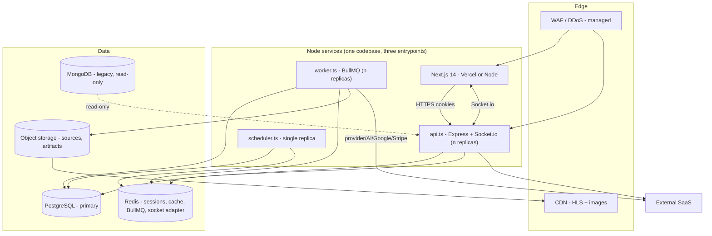

# CreatorFlow — Infrastructure & Deployment

Status: **Proposed**. Verified current state: no CI (`.github/` absent — V15), no container/deploy configuration anywhere in the repository, secrets in working-tree env files with no `server/.gitignore` (V18), CORS hard-locked to `http://localhost:3000` (`server/server.ts:27-32`), single-process Express + MongoDB + Upstash Redis today (`server/server.ts`). Everything below is the target; **no infrastructure was provisioned and no configuration was modified** while writing this document.

---

## 1. Topology (target)

Three backend processes from one build (`SYSTEM_COMPONENT_ARCHITECTURE.md` §1): **api** (stateless, horizontally scaled), **worker** (scaled by queue lag), **scheduler** (exactly one replica — cron must not run twice). Socket.io uses the Redis adapter so any api replica can emit to any room.

## 2. Environments

| Env | Purpose | Data | Domains |
|---|---|---|---|
| **local** | developer machines | seeded Postgres/Redis, Mongo legacy optional | `localhost:3000` (client), `localhost:4000` (api) |
| **staging** | pre-production verification, OAuth testing-user mode | synthetic data only, no real customer workspaces | `staging.creatorflow.app` |
| **production** | live | real data; backups on | `app.creatorflow.app`, `api.creatorflow.app` |

Rule: production-like configuration in staging (same env **names**, different values) — Finding B's class of bug (two places defining one lifetime) must be impossible by construction: one config module, env supplies values only (`SECURITY_AND_THREAT_MODEL.md` SEC-03).

## 3. CI/CD

Nothing exists today (V15). Required pipeline per push/PR:

1. **Gate 0 (Phase 0):** `tsc --noEmit` in `server/` and `client/`, ESLint (incl. import-boundary rules, `TESTING_AND_QUALITY_STRATEGY.md` §5), secret scan (gitleaks-class).
2. **Gate 1:** unit + contract tests (`TESTING_AND_QUALITY_STRATEGY.md` §4), DB migration dry-run against ephemeral Postgres.
3. **Gate 2:** build (`next build`, `tsc`), image build, SBOM/dependency audit.
4. **Deploy:** staging auto on main; production = manual approval, blue/green or rolling; migrations run forward-only with a documented revert step (§7).
5. Post-deploy smoke: health (`/ping`-class), login, one read of each critical resource.

No deploy of application code is authorized or performed by this documentation sprint.

## 4. Configuration & secrets

- **Secrets** live only in the environment (host env / managed secret store) — never in the repo, never in the client bundle. Required names are listed in §9; values are never printed (V18 remediation: add `server/.gitignore` covering `.env*`, rotate everything that has sat in a working tree).
- **Client config** = only `NEXT_PUBLIC_*` values (publishable key, API origin). Stripe secret, DB URLs, Redis URLs, provider keys: server-only.
- **CORS** = explicit origin list per environment (staging/production domains), `credentials: true`; the hard-coded `localhost:3000` (V23) becomes a config value.
- **Feature flags** = simple boolean env/config rows; no flag service in v1.

## 5. Data stores

| Store | Role | Availability | Backup/DR |
|---|---|---|---|
| PostgreSQL | primary source of truth (ADR-002) | managed, multi-AZ target (*assumption: provider TBD*) | PITR + nightly logical backup; **quarterly restore rehearsal** |
| Redis | sessions, cache, BullMQ, socket adapter | managed (existing Upstash instance verified in `server/.env:26`) | no backup obligation — sessions are re-derivable, queue state is in Postgres job rows |
| Object storage | sources, artifacts, exports | versioning on, lifecycle per `DATABASE_SCHEMA_AND_ERD.md` §4 | cross-region replica for sources (*assumption: cost to confirm*) |
| MongoDB | legacy marketplace, **read-only** | existing | untouched until the separately planned migration (`MIGRATION_AND_IMPLEMENTATION_ROADMAP.md`) |

Rule: **Postgres job rows are the source of truth for every queue**; Redis holds only delivery state (`API_CONTRACT_AND_MODULES.md` §5.6). Redis loss must never lose a job.

## 6. Observability (normative metrics)

Referenced by `VIDEO_PROCESSING_ARCHITECTURE.md` §8 — the following are **first-class metrics** with dashboards and alerts from Phase 1 on:

| Category | Metrics |
|---|---|
| **Queues (critical)** | **queue lag** (oldest job age, per queue), **failure rate** (failed ÷ started, 15 min), **dead-letter count** (per queue, absolute), **upload failure rate** (upload sessions aborted/failed ÷ created) |
| Video | processing stage duration p50/p95, provider webhook latency, versions stuck > 30 min |
| Publish | jobs per state, `outcome_unknown` count (target: 0 open > 1 h), quota burn vs daily limit, reconciliation success rate |
| AI | jobs per state/task, invalid-output rate, retry rate, cost/day, override rate (`AI_PROVIDER_ARCHITECTURE.md` §6) |
| API | request rate, p50/p95 latency per route class, error rate by `error.code`, 4xx/5xx ratio, rate-limit hits, idempotency replays vs mismatches |
| Realtime | socket connections, rejected handshakes, room-join denials, per-user connection cap hits |
| Auth | logins, failed logins, refresh failures, session revocations (SEC-03 telemetry) |
| Business | active workspaces, versions created, approvals, publishes, storage bytes |

**Logistics:** structured JSON logs with `requestId`, `workspaceId` (when scoped), `userId` (when authed), `error.code` — never secrets, never raw `err.message` to clients (V19; server logs redact tokens/passwords). Error reporting service captures uncaught exceptions with release tags. Tracing: request spans across api → worker (propagate `requestId`/job payload metadata).

**Alerts (initial):** queue lag > 10 min sustained; dead-letter count > 0 on publish; upload failure rate > 10 %/15 min; error rate > 1 %/5 min; auth failure spike; quota burn > 80 %; certificate expiry; backup failure. Channels: on-call chat + email (email deliverability = Phase 0 pre-work, `CREATORFLOW_MASTER_ARCHITECTURE.md` §5).

**SLOs (initial, assumptions):** API availability 99.9 %, p95 read latency < 300 ms, socket delivery < 1 s, publish success ≥ 99 % excluding `outcome_unknown` reconciled within 1 h. Revisit after Phase 9 data.

## 7. Backup, migration & rollback

- **Migrations:** Prisma migrate + hand-written SQL for triggers/RLS/partial indexes (`DATABASE_SCHEMA_AND_ERD.md` §1.1). Forward-only in production; every migration ships with a tested down-step or a documented data-reversal procedure.
- **Deploy rollback:** redeploy previous image; feature flags for risky UI; DB rollback only via forward-fix migrations (never destructive down-migrations in prod).
- **Phase rollback:** each roadmap phase has explicit rollback notes (`MIGRATION_AND_IMPLEMENTATION_ROADMAP.md`).
- **Incident:** runbook covers provider outage (jobs park with `next_retry_at` — `VIDEO_PROCESSING_ARCHITECTURE.md` §8), Redis flush (sessions re-login; no job loss), Postgres restore rehearsal.

## 8. Local development

1. Prereqs: Node LTS, local or Docker Postgres + Redis, Mongo (legacy only), `.env` from `.env.example` (**`server/.env` must never be committed** — V18).
2. `server/`: `npm run dev` (api), `worker.ts`, `scheduler.ts` entrypoints; `client/`: `next dev`.
3. Seed script creates a workspace, four role users, one project with two versions (fixtures for the E2E journey).
4. Contract tests run against an ephemeral Postgres (`docker run`-class) — no shared dev database.

## 9. Environment contract (names only — values never in the repo)

Server: `NODE_ENV`, `PORT`, `DATABASE_URL`, `REDIS_URL` (verified present, `server/.env:26`), `SESSION_TTL`/`REFRESH_TTL` (**single source of truth — SEC-03; replaces today's `ACCESS_TOKEN_EXPIRE`/`REFRESH_TOKEN_EXPIRE` unit trap, `server/.env:22,24`**), `AUTH_ACCESS_SECRET`/`AUTH_REFRESH_SECRET`, `SESSION_MASTER_KEY` (token vault), `GOOGLE_CLIENT_ID`/`GOOGLE_CLIENT_SECRET`, `YOUTUBE_*`, `STRIPE_SECRET_KEY`/`STRIPE_WEBHOOK_SECRET`, `MUX_*` (or chosen provider), AI provider keys (per adapter), `SMTP_*`, `CLOUDINARY_*` (legacy), `VDOCIPHER_API_KEY` (legacy, until retired), `CORS_ORIGINS`.
Client (publishable): `NEXT_PUBLIC_API_URL`, `NEXT_PUBLIC_STRIPE_PUBLISHABLE_KEY`.

## 10. Setup tasks (accounts — lead times, from `CREATORFLOW_MASTER_ARCHITECTURE.md` §5)

| # | Task | Owner | Lead time | Needed by |
|---|---|---|---|---|
| 1 | Google Cloud project(s) + OAuth consent **verification submission** | owner | **weeks** | gates Phase 9 — start in Phase 0 |
| 2 | Video provider account (Mux recommended — D2/ADR-003) | owner | days–weeks | Phase 4 |
| 3 | AI provider credentials + rate-limit tiers (D3/ADR-009) | owner | days | Phase 6/7 |
| 4 | Email domain auth (SPF/DKIM/DMARC) | ops | days | Phase 0 pre-work |
| 5 | Stripe production account (D9/ADR-011) | owner | days | Phase 10 |
| 6 | Object storage + CDN accounts | ops | days | Phase 4 |
| 7 | Managed Postgres + Redis instances per environment | ops | hours–days | Phase 2 |
| 8 | Secret store + `.gitignore` + credential rotation | ops | immediate | Phase 0 (V18) |

None require code changes to *start*.

## 11. Open decisions & assumptions

- Cloud provider / hosting targets (Vercel vs container platform): **not decided** — no D-number assigned yet; decide with ADR-008 (repo/deploy layout) in Phase 1. Owner approval required for spend.
- CDN/vendor pricing, managed Postgres tier, storage egress: *assumptions* — verify before Phase 4 spend.
- Kubernetes: explicitly **not** required at launch (`SYSTEM_COMPONENT_ARCHITECTURE.md` §6).
- Multi-region: out of scope until a compliance requirement appears (D10/ADR-013).
