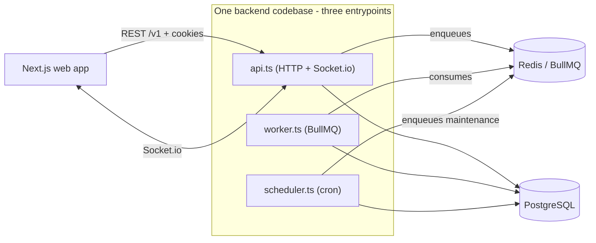
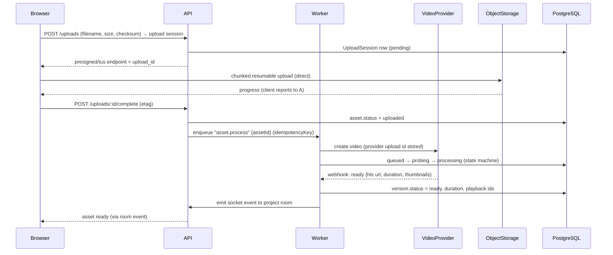

# CreatorFlow — System Component Architecture

Status: **Proposed** (references verified facts from `CREATORFLOW_MASTER_ARCHITECTURE.md` §0).

---

## 1. Architectural style (recommended)

**Modular monolith with separate background worker** (ADR-001):

- One TypeScript backend codebase (evolved from the current `server/`), compiled once, run as up to three process types:
  - **API process** — Express HTTP + Socket.io gateway.
  - **Worker process** — BullMQ consumers (video, AI, publish, cleanup queues).
  - **Scheduler process** — cron-style jobs (quota reset, calendar digests, retention sweeps).
- Frontend stays a **separate Next.js 14 app** (current `client/`), talking to the API over HTTPS cookies + Socket.io.
- **Not chosen:** Next.js API routes (long-running jobs, worker process, and reuse of the Express domain layer make them a poor fit); microservices (no scaling or team boundary justifies the distributed cost yet — extraction path is preserved via module boundaries).



---

## 2. Component inventory

| Component | Responsibility | Talks to | Deployable |
|---|---|---|---|
| **Web app** | Next.js 14 App Router UI, design system, RTK Query, review player, editors | API (HTTPS), Socket.io | Vercel or Node server |
| **API** | AuthN/AuthZ, REST endpoints, workspace scoping, upload sessions, socket rooms | Postgres, Redis, Stripe, email | Node container/service |
| **Worker** | All async jobs: probe/transcode watch, thumbnails, STT, AI generation, YouTube publish, cleanup | Postgres, Redis, video provider, AI gateway, Google APIs | Node container/service (scales independently) |
| **Scheduler** | Timed work: retention sweeps, quota reset, publish-at scheduling, notification digests | Postgres, Redis, API (enqueue) | Single-replica Node service |
| **Realtime gateway** | Authenticated Socket.io, room join/leave scoped to workspace/project | Redis (adapter), Postgres (auth) | Part of API process |
| **PostgreSQL** | Primary source of truth for all CreatorFlow entities | API, Worker, Scheduler | Managed Postgres |
| **Redis** | Sessions, cache, BullMQ, rate-limit counters, socket adapter | API, Worker, Scheduler | Existing Upstash/Redis |
| **MongoDB (legacy)** | VIDTOUCH marketplace data, read-only during migration | API (legacy routes only) | Existing, frozen schema |
| **Video provider** | Direct/resumable upload, transcode, HLS, thumbnails, duration | Worker (control), CDN (delivery) | External SaaS (Mux recommended) |
| **Object storage + CDN** | Original source files, thumbnail assets, published package artifacts, HLS delivery | API (presigned), Worker, Web | S3-compatible + CDN |
| **AI gateway (module)** | Provider adapters: STT, translation, LLM, image; cost + prompt versioning | Worker | In-process module |
| **YouTube publisher (module)** | OAuth, encrypted token vault, resumable upload, metadata, quota accounting | Worker | In-process module |
| **YouTube quota ledger (module)** | Per-project daily quota consumption and per-workspace monthly consumption; the only source for `GET /workspaces/:wsId/youtube/quota` | Worker, API | In-process module |
| **Stripe (module)** | Plans, subscriptions, webhooks, invoice events | API | External SaaS |
| **Email** | Invitations, review requests, publish results (transactional) | API, Worker | External SaaS |
| **Observability** | Logs (JSON), metrics, traces, error reporting | all | External SaaS or self-hosted |

---

## 3. Backend module layout (proposed directory structure)

Evolved from the current flat layout (`server/controllers|routes|models|services|middleware|utils`, verified). Modules own their routes, service, schema and tests; cross-module calls go through the module's public index only.

```
server/
  src/
    modules/
      identity/        # users, sessions, passwords, OIDC, verification, reset
      workspaces/      # workspace, members, invites, roles, RBAC
      projects/        # projects, project members, states
      assets/          # video assets, storage keys, upload sessions
      versions/        # immutable VideoVersion, processing status
      review/          # timestamp comments, replies, revisions, approvals
      captions/        # transcripts, segments, caption tracks, translations
      ai/              # AI jobs, outputs, prompt versions, cost records
      thumbnails/      # thumbnail concepts, assets, brand kits
      youtube/         # connections, token vault, quota ledger
      publishing/      # publish packages, publish jobs, calendar
      notifications/   # in-app + email fanout, preferences
      audit/           # append-only audit events
      usage/           # usage records, quotas, subscriptions, billing
      admin/           # platform administration (separate guards)
      <module>/        # every module has the same internal shape:
        routes.ts        # HTTP + socket entry points, role guards
        service.ts       # business rules, transactions, state machines
        repository.ts    # Prisma access — the ONLY place that touches tables
        schema.ts        # zod request/response schemas
        index.ts         # public surface; cross-module imports use this only
        *.test.ts        # unit + contract tests, colocated
    platform/          # db (prisma), redis, queue (bullmq), crypto, http, errors, config, logger
    legacy/            # migrated MongoDB controllers/routes kept for VIDTOUCH
    api.ts             # Express app assembly + routes + socket gateway
    worker.ts          # BullMQ workers registration
    scheduler.ts       # cron entrypoint
  prisma/
    schema.prisma
    migrations/        # Prisma migrations + hand-written SQL (constraint triggers, RLS)
  tests/               # cross-module integration + E2E suites
```

**Rules (canonical — this tree supersedes any other layout shown in the companion documents):**
- `legacy/` contains the migrated current code (V1–V27 findings fixed in Phase 0); no new features go there.
- Only `platform/db` and a module's own `repository.ts` touch Prisma; modules never import each other's tables directly.
- Cross-module calls go through the callee's `index.ts` public surface only.
- Queue producers live in modules; consumers live in `worker.ts`.
- **Import boundary (Finding C, `TESTING_AND_QUALITY_STRATEGY.md` §5):** code under `server/` must never be imported by code under `client/`, and vice versa. Shared, vendor-free, side-effect-free types/constants live in a dedicated `shared/` package imported by both. The rule is enforced by ESLint `no-restricted-imports` plus a CI check that fails when a client typecheck error references a path outside `client/`. The current violation at `client/redux/features/videos/videosApi.ts:1` is the proof that the rule must be enforced mechanically, not by convention.
- Prisma cannot express constraint triggers, row-level security or partial-unique indexes on expressions; those live in `prisma/migrations/<n>_*/migration.sql` as hand-written SQL and are part of the schema contract, not optional extras.

---

## 4. Key interaction flows (proposed)

### 4.1 Resumable upload → processing → ready



### 4.2 Review → approval → publish (invariant chain)

```mermaid
flowchart LR
    V[VideoVersion ready] --> S[submit: version.reviewState=submitted]
    S --> R[owner comments on exact versionId]
    R --> REV[editor uploads new version]
    REV --> S2[submit again]
    S2 --> A["approve(versionId, expectedUpdatedAt)"]
    A --> PKG[PublishingPackage built from approved version only]
    PKG --> PB[PublishJob idempotent]
    PB --> YT[YouTube upload]
```



**Invariant (enforced in DB + service layer):** a `publish_job` may reference only a `video_version` that carries an `approval` row whose `decision = 'approved'`, and that approval must reference the **same** `version_id`.

Enforcement is now stated precisely (the earlier wording overstated it):

| Layer | Mechanism |
|---|---|
| DB | FK `publish_job.version_id → video_version(id) ON DELETE RESTRICT`; FK `publish_job.approval_id → approval(id)`; composite FK `(workspace_id, version_id) → video_version(workspace_id, id)`; **constraint trigger `publish_job_requires_approved_version`** (hand-written SQL migration) that rejects INSERT/UPDATE unless the referenced approval has `decision='approved'` and `approval.version_id = publish_job.version_id` |
| Service | `publishing.service` re-checks the same predicate inside the same transaction as the state transition, and returns `409 VERSION_NOT_APPROVED` when it fails |
| Contract test | `TESTING_AND_QUALITY_STRATEGY.md` §4 publishes a package built on an unapproved version and asserts a DB-level rejection, not only an API-level error |

The trigger is what makes the invariant true for any writer, including a future console script or a data migration.

### 4.3 Realtime

- Handshake: `io.use()` validates the session cookie → resolves the user and their workspace memberships; unauthenticated sockets are rejected before any room can be joined.
- **Canonical room names** (normative; every room carries the workspace prefix so tenancy is never inferred from the room name alone):

| Room | Joined by | Purpose |
|---|---|---|
| `ws:{workspaceId}` | any member of that workspace | workspace-scoped events (processing progress, notifications) |
| `ws:{workspaceId}:prj:{projectId}` | members of the workspace **and** the project | project-scoped events (version ready, comment created) |
| `ws:{workspaceId}:ver:{versionId}` | members of the workspace **and** the project owning the version | version-scoped events (approval decided, publish progress) |

- A join is re-checked against the membership table on every request and re-validated when a membership is revoked; a revoked member is removed from all rooms and receives a `session.revoked` event.
- Events are **notifications of fact** (e.g. `version.ready`, `comment.created`, `publish.progress`); clients re-fetch authoritative state over REST. No business logic in events. This fixes V9 (verified leak at `server/socketServer.ts:9-14`).

---

## 5. Frontend component architecture (summary)

Full detail in `FRONTEND_DESIGN_SYSTEM.md`:

- **Routing**: App Router route groups `(public)`, `(auth)`, `(app)`. The tenant boundary is the `/workspaces/[wsId]/…` segment — **not** `/workspace/[wsId]` as an earlier draft of this document implied; the canonical route table for all 27 screens is `FRONTEND_DESIGN_SYSTEM.md` §3 and is normative. Layout per segment: app shell, project shell, review workspace shell.
- **Server components** for data scaffolding/SEO pages; **client components** for player, editors, realtime, forms.
- **State**: RTK Query as the single server-state layer (existing `client/redux` pattern kept), local Zustand/React state for UI-only state; no global auth token in JS (cookie sessions).
- **API integration**: one `baseQuery` with `credentials: "include"`, error interceptor → toast + 401 re-login path.

---

## 6. What is deliberately NOT in this architecture

- No microservices, no message bus beyond BullMQ, no GraphQL, no Kafka, no separate "AI service" deployment, no Kubernetes requirement for launch, no service mesh.
- Extraction seams (if ever needed): `modules/youtube`, `modules/ai`, and `modules/assets` are the only candidates, and only when evidence (independent scaling or team ownership) appears.
