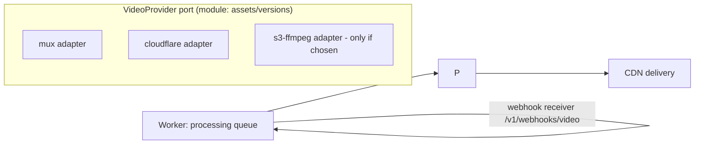

# CreatorFlow — Video Processing Architecture

Status: **Proposed** (provider choice = open decision **D2**).

---

## 1. Current state (verified)

- There is **no** real video pipeline. "Upload" = base64 data-URI inside a 50 MB JSON body, pushed to Cloudinary by the API process (`server/server.ts:24`, `server/controllers/video.controller.ts:17-36`).
- Playback is a VdoCipher OTP minting endpoint with **no authentication** (`server/routes/video.route.ts:31`, `server/controllers/video.controller.ts:491-511`).
- No transcoding, no HLS, no duration probing, no thumbnail extraction, no worker, no queue (verified absence of FFmpeg/queue dependencies in `server/package.json`).
- Cloudinary is only used for thumbnails/avatars (`user.controller.ts:368-388`, `video.controller.ts:23-29`).

Everything below replaces that pattern.

---

## 2. Provider alternatives (examined)

| Criterion | **Mux** (recommended primary) | **Cloudflare Stream** (recommended fallback) | **S3-compatible + FFmpeg workers + CDN** (escape hatch) |
|---|---|---|---|
| Direct/resumable upload | Yes — direct upload with signed URL; also accepts multipart | Yes — tus-style resumable uploads | Presigned multipart to bucket |
| Transcoding + HLS | Managed, automatic | Managed, automatic | Self-built FFmpeg jobs (ops burden) |
| Thumbnails / storyboard | Managed (static + animated storyboard) | Managed (thumbnails + video previews) | FFmpeg extraction job |
| Video duration/probe | Returned with asset | Returned with asset | ffprobe job |
| Playback security | Signed JWT playback policies | Signed tokens / GEO restrictions | Signed CDN URLs (build yourself) |
| Storage of source | Retained (configurable) | Retained 30 days min (verify) | Full control |
| Cost model | Per minute delivered + storage (assumption — verify pricing) | Per minute delivered + cheaper storage (assumption) | Storage + egress + compute; no per-minute video tax |
| Vendor lock-in | Moderate (export = source file + renditions) | Moderate | Lowest (S3 portable) |
| Ops effort | Lowest | Lowest | Highest (FFmpeg patching, scaling, failure handling) |
| Webhooks | Yes (asset.ready, etc.) | Yes | You build them |

**Recommendation:** **Mux primary**, wrapped behind a `VideoProvider` port; **Cloudflare Stream** as documented fallback (same port, second adapter); **S3 + FFmpeg** retained only if both are rejected for cost/compliance reasons (D2). The port exists precisely because provider pricing/approval is an external dependency that can move.

---

## 3. Upload design

### 3.1 Flow (resumable, direct-to-storage)

1. `POST /v1/workspaces/:wsId/uploads` (editor+, `Idempotency-Key`, zod: filename/bytes/sha256/mime) → validates quota (`storage_quota`), creates `upload_session`, returns either:
   - **Provider direct upload URL** (Mux/CF) or
   - **S3 presigned multipart** (part URLs, part size 8–16 MB).
2. Browser uploads **directly** — API/worker never stream bytes (reverses V12).
3. Client reports progress; `POST .../uploads/:uploadId/complete` with checksum → asset `uploaded` → job enqueued.
4. Resumability: `GET .../uploads/:uploadId` returns bytes/part status; expired sessions (48 h) swept by cleanup queue.

### 3.2 Validation & abuse controls

- Allow-list: `video/mp4`, `video/quicktime`, `video/webm`, `video/x-matroska`; extension match; size ≤ plan limit; sha256 checked server-side after completion.
- **No URL ingestion**: endpoints never accept a remote URL to fetch (SSRF class eliminated; current code passes arbitrary data to Cloudinary).
- Probe before transcode (container, codecs, duration, resolution, frame rate); suspicious/invalid media → `failed` with `error_code=invalid_media`, never executed.
- Rate limits per `API_CONTRACT_AND_MODULES.md` §1.6; per-workspace concurrent-upload cap (default 3).

---

## 4. Processing pipeline (queues)

BullMQ queues (Redis, existing dependency), one queue per stage family; every job carries `idempotency_key` (unique in `video_processing_job`).

| Queue | `video_processing_job.stage` | Job | Worker actions | `max_attempts` |
|---|---|---|---|---|
| `asset.process` | `provider_asset` | create provider asset, register webhook | call provider, store `provider_asset_id`, state `queued→probing` | 4 |
| `video.probe` | `probe` | fetch duration/codecs/resolution | write asset + version duration/dimensions, `probing→processing` | 4 |
| `video.transcode` | `transcode` | provider transcode (or FFmpeg ladder in fallback) | HLS renditions, `processing→ready` on webhook | 4 |
| `video.thumbnail` | `thumbnail` | storyboard + frame thumbnails | extract N frames + 1280×720 stills → object storage | 4 |
| `video.audio` | `audio` | audio track extraction | mp4a/wav for STT, stored `storage_key` | 4 |
| `video.validate` | `validate` | checksum/DRM-lite sanity, playback-id issuance | set playback token policy | 4 |
| `lifecycle.cleanup` | *(not a `video_processing_job`)* | deletion sweeps, expired sessions/uploads, retention | storage deletes + audit rows | 3 |

**Retry semantics (canonical).** `max_attempts` is the **total** number of attempts including the first one: `max_attempts = 4` means 1 initial attempt + 3 retries. This corrects the earlier draft, which used three different vocabularies in three columns — "3 retries" (which reads as 4 attempts), "3 retries, then `failed`", and "2 retries" for `video.validate` — so the actual attempt budget depended on which row you read. The single canonical table, covering every queue including AI and publish, is `API_CONTRACT_AND_MODULES.md` §5.6. `video.validate` now has the same budget as the other stages.

**`provider_asset` stage (resolved).** The `asset.process` queue had no matching `video_processing_job.stage` value — the enum was `probe|transcode|thumbnail|audio|validate` — so provider-asset creation had no row to record its attempts in. The value `provider_asset` was added.

**`lifecycle.cleanup` is not version-scoped (resolved).** Cleanup jobs sweep expired uploads, deleted projects, archived workspaces and old audit rows. They have no `version_id`, so they are **not** `video_processing_job` rows. The intent is recorded in `cleanup_task` (`DATABASE_SCHEMA_AND_ERD.md` §2.3.1); the queue carries the execution. Modelling them as processing jobs would have forced a bogus `version_id` onto every cleanup row.

(Transcription/translation/AI/thumbnail-AI/publish queues live in their own documents — `AI_PROVIDER_ARCHITECTURE.md` §4, `YOUTUBE_PUBLISHING_ARCHITECTURE.md` §6 — but run on the same BullMQ instance with separate queue names and concurrency limits.)

### 4.1 State + webhook handling

- Provider webhooks arrive at `POST /v1/webhooks/video/:provider` (HMAC-verified, timestamped, replay-protected), mapped to idempotent state transitions: duplicate webhooks are no-ops (job row already terminal).
- Socket event `processing.progress` emitted to `ws:{workspaceId}` room after each transition (API validates room membership — fixes verified broadcast leak V9).

### 4.2 Immutability

Once a version reaches `ready`, its media columns (`storage_key`, `duration_seconds`, `provider_asset_id`, `playback_ids`, `checksum`) are immutable (DB trigger + service rule). Re-cutting = **new `video_version` row**.

---

## 5. Playback

- `GET /v1/workspaces/:wsId/versions/:id/playback` → membership check → short-lived (5 min) signed playback URL/token for HLS manifest + segments.
- Player: HLS.js in the review workspace (no YouTube embed for review; frame-accurate seeking is required for timestamped comments).
- Never expose provider secrets; never mint playback tokens for unauthenticated callers (reverses V11).
- Download of source: separate permission (`admin`+, watermarked optional later — not in v1 scope).

---

## 6. Thumbnails & artifacts (processing side)

- Storyboard (WebVTT + sprite) for scrubbing in review.
- Frame captures → `thumbnail_asset` candidates feeding Thumbnail Studio (concepts are separate — see AI doc).
- All artifacts to object storage under `ws/{workspaceId}/project/{projectId}/version/{versionId}/...` — keys always embed workspace for lifecycle rules and defense-in-depth.

---

## 7. Cost controls & quota

| Control | Mechanism | Counter / source |
|---|---|---|
| Storage | checked at upload session create; over-quota → 429 `QUOTA_EXCEEDED` | `storage_quota.storage_bytes_used` (reconciled from `video_asset.byte_size`) |
| Minutes processed | counted on `ready` | `storage_quota.video_minutes_used` ← `usage_record(metric='video_minutes')` ← `video_version.duration_seconds` where `processing_state='ready'` |
| AI tokens | counted per AI job | `storage_quota.ai_tokens_used_month` ← `usage_record(metric='ai_tokens')` ← `ai_output.tokens_in + tokens_out` |
| YouTube publish quota | counted per YouTube API call that consumes quota | `storage_quota.publish_quota_units_used` (monthly, per workspace) **and** `youtube_quota_ledger` (daily, per Google Cloud project) — `usage_record(metric='publish_quota_units')` is the metering line between them |
| Provider minutes | monthly report per workspace; alert at 80% of plan allowance | provider billing API (read-only, separate from CreatorFlow counters) |
| Source retention | `keep_sources` setting: originals purged after approved publish if disabled (versions stay) | `workspace.settings.keep_sources` |
| Concurrent transcodes | per-worker concurrency limit + workspace fair-share (weighted queue) | queue config |
| Failed-job spend | dead-letter review in admin; no infinite retries | `video_processing_job.attempt` vs `max_attempts` |

**Counter names (resolved).** The earlier draft named `storage_quota` counters inconsistently across documents (`ai_tokens_used` vs `ai_tokens_used_month`, and no publish counter at all). The canonical names are the four columns of `storage_quota` in `DATABASE_SCHEMA_AND_ERD.md` §2.9 — `storage_bytes_used`, `video_minutes_used`, `ai_tokens_used_month`, `publish_quota_units_used` — plus `seats_used`. `GET /workspaces/:wsId/usage` returns exactly these five.

---

## 8. Reliability

- All stages idempotent (unique `idempotency_key`, terminal-state guard).
- Webhook receiver is at-least-once safe; processing queue is exactly-once-*effective* via job-row state machine.
- Queue lag, failure rate, dead-letter count, upload failure rate are first-class metrics (`INFRASTRUCTURE_AND_DEPLOYMENT.md` §6).
- Provider outage: jobs park with `next_retry_at`; API stays up (review of existing ready versions unaffected).

---

## 9. Open decisions & assumptions

- **D2 / ADR-003** primary video provider (Mux recommended, Cloudflare Stream as fallback adapter) — *Open*: needs budget sign-off. Registered in `ARCHITECTURE_DECISION_RECORDS.md`.
- *Assumption:* provider pricing, storage retention minimums, and webhook delivery guarantees — verify against current vendor docs before the Phase 4 build. **Not verified in this repository.**
- *Assumption:* no DRM/DRM-level access control required at launch; signed playback assumed sufficient.
- *Open:* whether source-file download by editors is allowed in v1 (recommend: yes, workspace setting, audited).

- **Open (OD-05):** whether source-file download by editors is allowed in v1. Recommendation: yes, as a workspace setting, audited. Not ratified.
- **Open (ADR-003 implementation detail):** the video provider's own quota/throughput limits are not yet mapped to per-plan limits in `storage_quota.limits`. Recommendation: cap concurrent transcodes per workspace and expose the provider's daily allowance in the admin console; the exact numbers need provider confirmation before Phase 4. This is part of the provider decision (ADR-003), not a separate open decision.

### 9.1 Acceptance criteria for the processing pipeline

| # | Criterion |
|---|---|
| VP-1 | Every queue stage has a `video_processing_job.stage` value and a canonical `max_attempts` (4 for video stages, 3 for cleanup) |
| VP-2 | A duplicated webhook for an already-terminal job is a no-op and creates no second row |
| VP-3 | A version reaching `ready` rejects any UPDATE of its media columns (DB trigger) |
| VP-4 | No upload path accepts a remote URL; bytes travel directly from the browser to the storage target |
| VP-5 | Playback tokens are never minted for an unauthenticated or non-member caller |
| VP-6 | A dead-lettered job appears in `/admin/jobs/dead-letter` with `error_code`, `attempt` and `max_attempts` |
