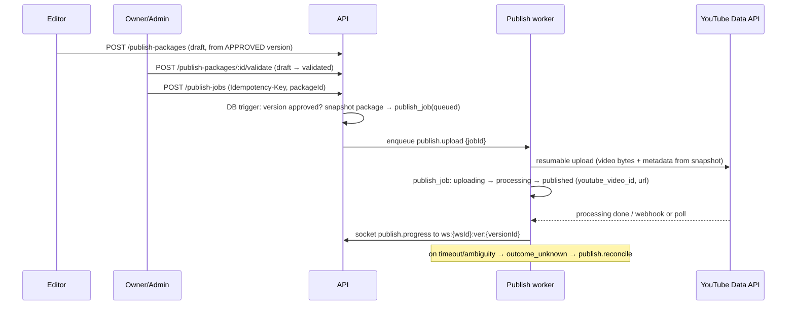

# CreatorFlow — YouTube Publishing Architecture

Status: **Proposed**. Verified: **no YouTube integration code exists anywhere in the repository** (no Google APIs client, no OAuth code, no YouTube Data API usage — `server/package.json`, `client/package.json`, repo-wide source inspection; recorded as V16 in `CREATORFLOW_MASTER_ARCHITECTURE.md` §0.1). Everything below is greenfield design.

Companion registers: quota scope = **OD-06** and **ADR-010** (`ARCHITECTURE_DECISION_RECORDS.md`); token/publish threats = **SEC-13/14/15** (`SECURITY_AND_THREAT_MODEL.md`); publish queue retries = `API_CONTRACT_AND_MODULES.md` §5.6 (canonical).

---

## 1. Scope

Four responsibilities:

1. **Channel connections** — Google OAuth 2.0, consent-screen verification, encrypted token vault.
2. **Quota accounting** — daily Google Cloud project quota and per-workspace monthly publish units.
3. **Publish pipeline** — worker-driven, idempotent upload of an **approved immutable version** with a frozen metadata snapshot.
4. **Reconciliation** — resolving `outcome_unknown` jobs without creating duplicate videos.

Non-goals (v1): comment/reply automation, analytics ingestion, multi-channel bulk publishing, YouTube Studio embed.

---

## 2. Connection model

| Concern | Design |
|---|---|
| Entity | `youtube_connection` (`DATABASE_SCHEMA_AND_ERD.md` §2.8): `UNIQUE(workspace_id, channel_id)`, `status` (`active\|revoked\|error`) |
| Scopes requested | `youtube.upload` + `youtube.readonly` (`API_CONTRACT_AND_MODULES.md` §3.12) — least privilege for insert + verification reads |
| Who may connect | `owner` only (`POST /workspaces/:wsId/youtube/connections/authorize`) |
| Who may disconnect | `owner` only; revokes at Google **and** marks the row `revoked` (both sides, in that order) |
| Transport | Authorization Code flow with **server-side state + PKCE**; callback `GET /youtube/callback` stores the encrypted refresh token and writes `audit_event` `yt.token.granted` |
| Response invariant | No column of `youtube_connection` is ever selected into an API response shape — `GET .../youtube/connections` returns id, channel title/thumbnail/status/scopes only |

### 2.1 Token vault

- `refresh_token_enc`: **AES-256-GCM envelope encryption** — data key per row, data key wrapped by a master key from the environment/KMS. Never leaves the server, never logged, never in a response.
- `access_token_enc`: short-lived (Google access tokens ≈1 h — *assumption, verify at integration*), cached only to avoid a refresh round-trip per job; **refreshed inside the worker**, not the API process.
- `token_expires_at` drives proactive refresh; a refresh failure flips `status='error'` and fails all queued jobs for that connection with `error_code=invalid_credentials` (non-retryable per `API_CONTRACT_AND_MODULES.md` §5.6).
- Rotation: a re-consent replaces the row's tokens and keeps `granted_at` history in `audit_event`.
- Comparison with current code (verified analogue): the present codebase returns bearer tokens in JSON bodies (`server/utils/jwt.ts:47-52`) — the exact pattern this design forbids for Google tokens.

---

## 3. Google OAuth consent-screen verification (longest lead time)

`youtube.upload` is a **restricted/sensitive scope**; unverified apps are limited to testing users and short-lived test credentials.

| Item | Detail |
|---|---|
| Lead time | **Weeks** (assumption — Google does not publish a fixed SLA; verify at submission) |
| Start when | **Phase 0** of `MIGRATION_AND_IMPLEMENTATION_ROADMAP.md` — before any publish code is written |
| Gates | Phase 9 (publishing) cannot leave test mode without it; this is the single longest pole in the roadmap (`CREATORFLOW_MASTER_ARCHITECTURE.md` §5) |
| Needs | Verified domain, privacy policy URL, app screencast of the flow, publishing-domain ownership record |
| Interim | Phase 5–8 development uses testing-user mode; only `owner` test accounts can connect a channel |

Nothing in this section requires code changes to *start* — account, domain and verification-submission work is scheduled in Phase 0.

---

## 4. Quota accounting

Two counters, one metering line (resolved — see `DATABASE_SCHEMA_AND_ERD.md` §2.8 and §2.9):

| Counter | Scope | Written by | Read by |
|---|---|---|---|
| `youtube_quota_ledger` (`quota_scope='project'`, `quota_date`, `units_used`, `limit_units`) | Google Cloud project, daily | publish worker after **every** quota-consuming YouTube API call | `GET /workspaces/:wsId/youtube/quota` (today's row + reset time) |
| `storage_quota.publish_quota_units_used` | workspace, monthly | same worker via `usage_record(metric='publish_quota_units')` | `GET /workspaces/:wsId/youtube/quota`, `GET /workspaces/:wsId/usage` |
| `publish_job.quota_units` | per job | recorded at completion | job detail, cost reports |

- Pre-flight check at `POST /publish-jobs` validation: remaining daily project quota ≥ estimated cost, else `429 QUOTA_EXCEEDED`.
- **Open (OD-06):** whether YouTube Data API quota is granted **per Google Cloud project** (assumed) or per channel. If per channel, `youtube_quota_ledger`'s key and `limit_units` change. Must be verified against current Google documentation before Phase 9. The daily default of **10 000 units** is an *assumption* (`DATABASE_SCHEMA_AND_ERD.md` §2.8).
- Unit costs per operation (e.g. `videos.insert`) are *assumptions* to be confirmed against current Google documentation before Phase 9; the ledger stores units, not operations, so a cost-table change is configuration, not schema.

---

## 5. Publish pipeline

### 5.1 End-to-end flow

### 5.2 Invariants (all normative elsewhere; restated here as the publishing view)

1. **Approved immutable version only.** `publish_job` references `version_id` + `approval_id`; DB constraint trigger `publish_job_requires_approved_version` rejects any row whose approval is not `decision='approved'` for the **same** version (`DATABASE_SCHEMA_AND_ERD.md` §2.8, `SYSTEM_COMPONENT_ARCHITECTURE.md` §4.2). The service re-checks in-transaction and returns `409 VERSION_NOT_APPROVED`.
2. **Frozen metadata.** `package_snapshot` is copied inside the enqueue transaction. Editing the package after enqueue can never alter an in-flight upload; it supersedes the job (`error_code='package_superseded'`).
3. **One job per (workspace, version, channel).** `publish_job.idempotency_key = workspace:version:channel` — no attempt counter (`API_CONTRACT_AND_MODULES.md` §1.5). A retry resumes the same row.
4. **Roles.** Enqueue/retry = `owner`/`admin` (`requireRole`); editors prepare `draft` packages only (`API_CONTRACT_AND_MODULES.md` §1.7, §3.13 — **OD-04**, resolved).

### 5.3 Job states

Exactly `queued → uploading → processing → published | failed | outcome_unknown` with the transitions of `API_CONTRACT_AND_MODULES.md` §5.4. `draft`/`validated` are **package** states and never appear on the job.

### 5.4 Reconciliation (`outcome_unknown`)

Ambiguity sources: upload timeout after bytes were accepted, lost callback, process crash mid-insert.

1. Worker searches the channel for videos created in the job's window carrying the idempotency marker (the job key stored in the video's `description` marker block or `tags` — *design assumption: marker format finalized in Phase 9*).
2. Found → adopt: store `youtube_video_id`, `youtube_url`, state `published`.
3. Not found → state `failed` (`error_code=reconciliation_empty`), then owner/admin may `POST .../retry` — same row, same key (`API_CONTRACT_AND_MODULES.md` §4).
4. Every reconciliation decision writes `audit_event`.

The retry endpoint performs this search **before** any re-upload — never a blind second insert (SEC-14, `SECURITY_AND_THREAT_MODEL.md`).

---

## 6. Publish queues (BullMQ)

Declared here because the video document defers publish queues to this file (`VIDEO_PROCESSING_ARCHITECTURE.md` §4). Same Redis/BullMQ instance as video and AI queues, separate names and concurrency.

| Queue | Job payload | Stages driven | `max_attempts` | Backoff | Concurrency |
|---|---|---|---|---|---|
| `publish.upload` | `{publishJobId}` (idempotency key = job row's) | `queued → uploading → processing → published / failed / outcome_unknown` | **5** (1 initial + 4 retries) | exponential + jitter, base 5 s, cap 15 min | 4 (global), weighted fair-share per workspace |
| `publish.reconcile` | `{publishJobId}` | `outcome_unknown → published / failed` | **5** (same budget row as `publish.upload` — see the canonical publish row in `API_CONTRACT_AND_MODULES.md` §5.6) | fixed 60 s | 2 |

Rules (canonical source for all queues: `API_CONTRACT_AND_MODULES.md` §5.6):

- `attempt` counts attempts started, starting at 1; dead-letter when `attempt >= max_attempts`.
- Retryable: 429, 5xx, network timeout, resumable-upload interruption. Non-retryable: quota exceeded, invalid/revoked credentials, policy violation (→ `failed` immediately, visible in `/admin/jobs/dead-letter`).
- Manual `POST .../publish-jobs/:id/retry` (owner/admin, from `failed`/`outcome_unknown` only) resumes the **same row and key**; it never creates a second job and never resets `max_attempts` (`API_CONTRACT_AND_MODULES.md` §5.6). **Undefined in v1:** how a *dead-lettered* publish job (attempts exhausted) is re-opened, given that the unique idempotency key forbids a second job for the same `workspace:version:channel` — registered as a Phase 9 design task, deliberately not improvised here.
- Duplicate `publish.upload` deliveries for one job row are no-ops (job-row state machine is terminal-safe).

---

## 7. Security mapping

| Threat | Register | Control in this document |
|---|---|---|
| YouTube token theft | **SEC-13** | envelope encryption (§2.1), no-token responses (§2), worker-only refresh, audit on grant/revoke |
| Duplicate publishing | **SEC-14** | idempotency key without attempt counter (§5.2.3), reconciliation-before-retry (§5.4), snapshot rule (§5.2.2) |
| Unauthorized publishing | **SEC-15** | owner/admin-only enqueue and validate (§5.2, item 4), DB trigger for approved version (§5.2, item 1), audit events on every transition |
| Workspace isolation | SEC-04 | composite FK `(workspace_id, version_id)` on `publish_job`; all queries workspace-scoped (`DATABASE_SCHEMA_AND_ERD.md` §1.1) |

Full remediation, attack scenarios, regression tests and acceptance criteria: `SECURITY_AND_THREAT_MODEL.md` SEC-13/14/15.

---

## 8. Acceptance criteria

| # | Criterion |
|---|---|
| YT-1 | No API response shape ever contains `access_token_enc` / `refresh_token_enc` (contract test, `TESTING_AND_QUALITY_STRATEGY.md` §4) |
| YT-2 | A `publish_job` insert against an unapproved version is rejected by the **DB trigger**, not only the API (test DB-2) |
| YT-3 | Enqueueing the same (package, connection) twice with the same Idempotency-Key returns the original job; with a different body → `409 IDEMPOTENCY_MISMATCH` |
| YT-4 | A retry after failure resumes the same `publish_job.idempotency_key`; no second row exists afterward |
| YT-5 | `outcome_unknown` reconciliation finds the marker before any re-upload; a re-upload without a failed reconciliation is a test failure |
| YT-6 | Every quota-consuming API call increments `youtube_quota_ledger` and `usage_record(metric='publish_quota_units')` in the same transaction as the job update |
| YT-7 | Revoking a connection at Google flips the row to `revoked` and fails queued jobs with `invalid_credentials` (non-retryable) |
| YT-8 | Dead-lettered publish jobs appear at `/admin/jobs/dead-letter` with `error_code`, `attempt`, `max_attempts` |

---

## 9. Open decisions

| ID | Decision | Recommendation | Status |
|---|---|---|---|
| **ADR-010 / D8** | Google Cloud project per environment & quota budget | New project per environment; submit consent verification in Phase 0 | **Open** — owner approval required |
| **OD-06** | Quota scope: per Google Cloud project (assumed) vs per channel | Verify against current Google docs before Phase 9; ledger key changes if per channel | **Open** |
| — | Reconciliation marker format (description block vs tags) | Description marker block, stripped of user text | Proposed — finalize in Phase 9 |
| — | Manual retry after dead-letter | Allowed only with audited `?force=true` escalation | Proposed — finalize in Phase 9 |

*Assumptions (not verifiable from this repository):* Google unit costs, daily quota default, access-token lifetime, verification lead time. Verify before Phase 9.
